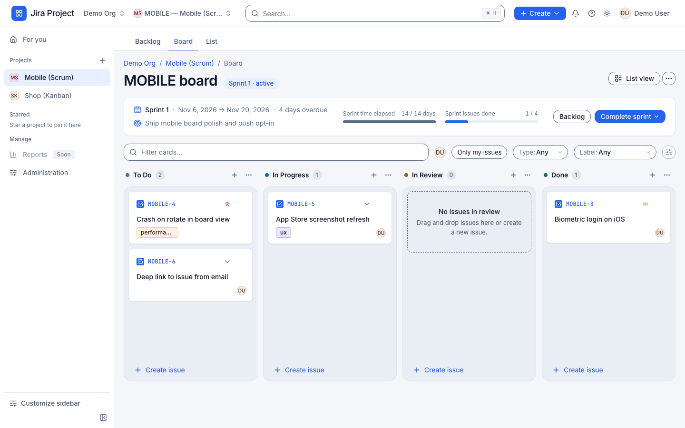
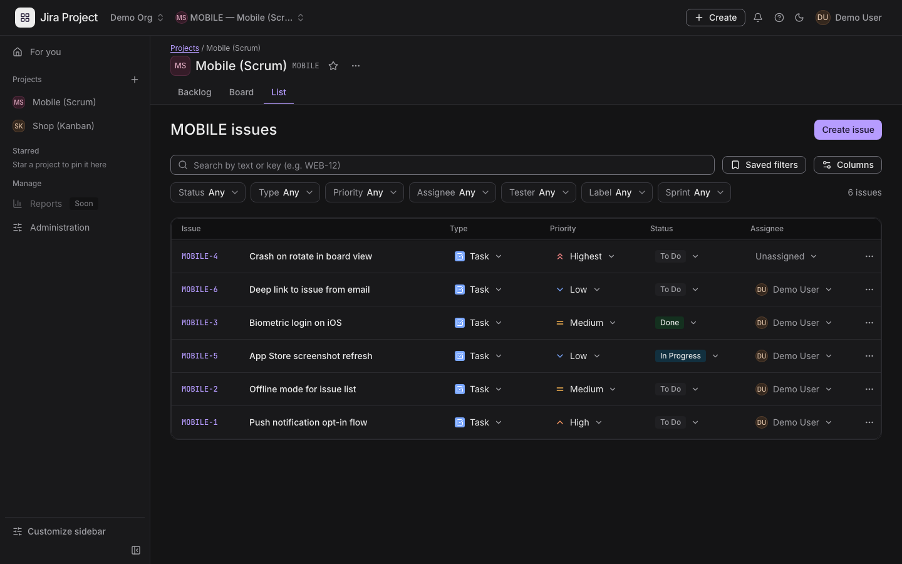
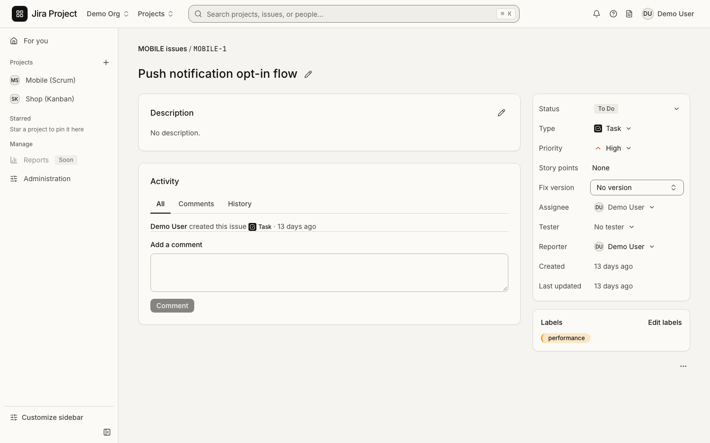
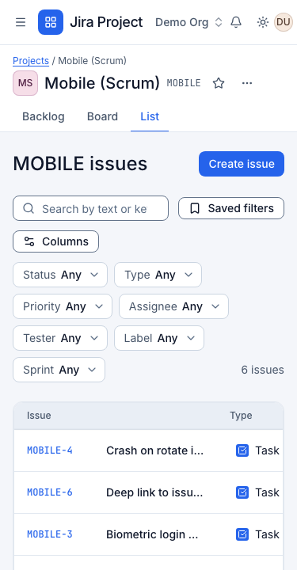
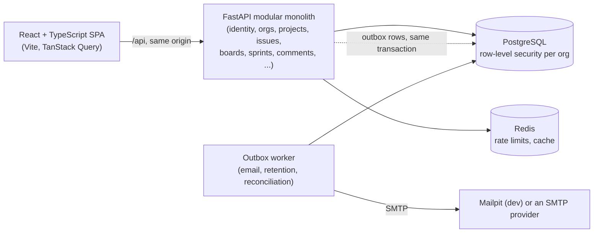

# Jira Project

[](https://github.com/Anirudhani01/jira-project/actions/workflows/ci.yml)

A multi-tenant, Jira-style work management app for small teams: organizations contain projects, projects contain issues, and issues move through configurable workflows on Kanban and Scrum boards. Built as a full-stack portfolio project with a focus on security, data isolation and quality: React + TypeScript on the front, a FastAPI modular monolith on the back, and PostgreSQL row-level security keeping every organization's data apart.

<table>
  <tr>
    <td></td>
    <td></td>
  </tr>
  <tr>
    <td align="center">Scrum board (light)</td>
    <td align="center">Issue list (dark)</td>
  </tr>
  <tr>
    <td></td>
    <td align="center"></td>
  </tr>
  <tr>
    <td align="center">Issue detail (paper)</td>
    <td align="center">Phone layout</td>
  </tr>
</table>

Three themes (light, dark and an off-white "paper" theme) and layouts from phone to desktop. More screenshots, with results for every page, are in [`docs/ui-redesign/evidence/2026-11-24-responsive-qa/`](docs/ui-redesign/evidence/2026-11-24-responsive-qa/README.md).

## Try it

A hosted demo is **not running at the moment** (it is on the backlog: [`docs/MVP-STATUS.md`](docs/MVP-STATUS.md), item B1). It runs locally in a few minutes:

```bash
make install        # backend + frontend dependencies from lockfiles
make dev            # PostgreSQL, Redis and Mailpit in Docker; migrations; API, worker and web
make seed-demo      # in a second terminal: a demo organization with projects and issues
```

Open http://localhost:5173 and sign in with the demo account (credentials are in the header of [`backend/app/scripts/seed_demo.py`](backend/app/scripts/seed_demo.py)). Details are under [Quick start](#quick-start).

## What it does

- **Organizations and access control:** multiple organizations, roles (owner, admin, member), email invitations, per-project roles (admin, member, viewer), an audit log and an authentication-activity view.
- **Projects and issues:** Epic, Story, Task, Bug and Sub-task types; priorities, labels, comments (Markdown, sanitized on the server), assignee, reporter and tester, story points, fix versions and releases, per-issue activity history, search, filters, saved filters, bulk actions, and a project Summary page (status distribution, types, priorities).
- **Workflows and boards:** data-driven workflows with an editor (statuses and transitions per project), a Kanban board with drag and drop, and a Scrum backlog with sprints.
- **Notifications and admin:** in-app notifications, email through an outbox worker, and an admin console for catalogs (issue types, priorities), members, invitations, audit logs and workflows.
- **Everyday quality:** loading, empty, error, permission-denied and session-expiry states everywhere, an online/offline indicator, keyboard support and three accessible themes.

## Architecture



- **Modular monolith with a separate worker** ([ADR 0001](docs/adr/0001-modular-monolith.md)): one codebase, one database and ACID transactions across modules; each module has models, schemas, repository, service and router layers.
- **Tenant isolation in the database** ([ADR 0003](docs/adr/0003-tenancy-shared-schema-rls.md)): a shared schema with forced row-level security, composite foreign keys that keep every row inside its organization, and least-privilege database roles that the API checks at startup.
- **Revocable server-side sessions** ([ADR 0004](docs/adr/0004-identity-and-sessions.md)): Argon2id passwords, an opaque `__Host-` session cookie, CSRF tokens bound to the session and an `Origin` check on writes.
- **Data-driven workflows** ([ADR 0005](docs/adr/0005-data-driven-workflows.md)), **transactional outbox for email** ([ADR 0009](docs/adr/0009-outbox-worker-email-tokens.md)) and an **OpenAPI contract** whose TypeScript types are generated and drift-checked in CI.
- All decisions: [`docs/adr/`](docs/adr/README.md) and the [decision log](docs/decisions.md).

## Quality

| | |
|---|---|
| Backend tests | 696 integration tests (real PostgreSQL and Redis, including cross-tenant and row-level-security tests and a migration round trip) and 280 unit tests |
| Frontend tests | 617 unit and component tests |
| End-to-end | 13 user journeys (sign-up to sprint to audit) and 11 UX-state scenarios (offline, session expiry, permissions) in Playwright |
| Responsive and visual QA | 27 pages x 3 themes x 3 screen widths (243 combinations): no horizontal overflow and no serious accessibility (axe) violations ([results](docs/ui-redesign/evidence/2026-11-24-responsive-qa/README.md)) |
| CI | Parallel jobs (lint, types, unit, integration in 3 shards, frontend, OpenAPI drift, secrets scan, dependency audit): about 3 minutes |

Project status against the MVP definition: [`docs/MVP-STATUS.md`](docs/MVP-STATUS.md). Everything the app can do: [`docs/FEATURES.md`](docs/FEATURES.md).

**Cost policy:** zero paid software cost. No paid services, subscriptions, paid APIs or
provisioned paid resources without explicit owner approval (decision D14).

More documentation:

- Architecture plan (with Revisions 1–3): [`docs/architecture/phase-1-plan.md`](docs/architecture/phase-1-plan.md)
- Decision log: [`docs/decisions.md`](docs/decisions.md) · ADRs: [`docs/adr/`](docs/adr/README.md)
- UI redesign roadmap and progress: [`docs/ui-redesign-plan.md`](docs/ui-redesign-plan.md) (per-PR notes under [`docs/ui-redesign/`](docs/ui-redesign/))

## Prerequisites

| Tool | Version | Notes |
|---|---|---|
| Docker + Docker Compose v2 | recent | runs PostgreSQL 17 and Redis 7 |
| Python | 3.13 | `backend/.python-version` |
| [uv](https://docs.astral.sh/uv/) | 0.11.x | Python dependency manager (`backend/uv.lock`) |
| Node.js | 24 LTS | `.nvmrc`; enforced by `make node-version-check` and `engine-strict` (other majors fail) |
| pnpm | 10.28.0 | `corepack enable` picks it up from `frontend/package.json` |
| GNU Make | 4.x | |

Switch to the pinned Node version with `nvm use` or `fnm use` in the repository root.

## Quick start

```bash
cp docs/local-dev.env .env   # optional: local-only placeholder values; edit if you like
make install                # backend + frontend deps from lockfiles
make dev                    # Postgres, Redis, Mailpit in Docker; migrations; API :8000, worker, web :5173
```

Open http://localhost:5173. Emails sent in development are captured by Mailpit (nothing
leaves your machine): http://localhost:8025. The Vite dev server proxies `/api` to the API. Interactive API
docs (dev only): http://localhost:8000/api/docs.

Without a `.env`, the Makefile falls back to `docs/local-dev.env` (placeholder values
only; the backend refuses to start with placeholders in staging/prod). Root `.env.example`
lists production variable names for hosted deploys (see `DEPLOYMENT.md`).

Full stack in containers (production-like images, nginx serving the SPA on :8080):

```bash
make up      # build + start everything; http://localhost:8080
make down    # stop (keeps data)
make reset-db  # DESTRUCTIVE: also deletes the local database volume
```

## Common tasks

| Command | What it does |
|---|---|
| `make infra-up` | Start PostgreSQL, Redis and Mailpit and wait until healthy |
| `make seed-demo` | Demo organization, projects and issues (needs `make dev` running) |
| `make e2e-journeys` / `make e2e-visual-qa` | Playwright user journeys / responsive and visual QA sweep (need `make dev` and `make seed-demo`) |
| `make worker-dev` | Run the outbox worker locally (part of `make dev`) |
| `make migrate` | Apply migrations to the dev DB (as `app_owner`) |
| `make test` | Backend unit + integration tests (needs `infra-up`) and frontend tests |
| `make lint` / `make typecheck` / `make fmt` | ruff + ESLint/Prettier / mypy + tsc / auto-format |
| `make migrate-roundtrip` | upgrade → downgrade base → upgrade on the test DB |
| `make openapi` / `make openapi-check` | regenerate / drift-check `backend/openapi.json` |
| `make audit` | pip-audit + pnpm audit |
| `make secrets-scan` | gitleaks over git history and the working tree (Docker) |
| `make ci` | Install, infra, lint, typecheck, parallel tests, migration round trip, OpenAPI drift, build, audit, secret scan |
| `make ci-docs` | Docs-only PRs: gitleaks only (no app tests or Docker) |
| `make ci-backend` / `make ci-frontend` / `make ci-contract` | The pieces CI runs as separate parallel jobs |
| `make test-ci-scripts` | Tests for the CI helper scripts (path scope, test sharding, PR gate) |
| `make test-parallel` | Backend unit + integration + frontend tests in parallel |
| `make images` | Build backend and frontend container images locally (never pushed) |

CI (`.github/workflows/ci.yml`) runs the checks as **parallel jobs**: backend, three backend integration shards, frontend, API contract (OpenAPI drift), secrets scan, container images (on `main` or when Dockerfiles change) and mocked Playwright; a single required **`CI`** check decides from all of them. Pull requests that change only the frontend or only the backend skip the other side's job, and **docs-only** PRs run just a secrets scan. **`main`** always gets the full gate, and `make ci` runs everything in one go locally. See [`docs/ci.md`](docs/ci.md).

After merge to **`main`**, path-scoped pushes also run **E2E UX states** (`.github/workflows/e2e-ux.yml`): Playwright `e2e/ux-states.spec.ts` against a local dev stack (`make e2e-ux-states` with `make dev`). Not a PR-required check.


## Database roles

`infra/postgres/init/01-roles.sh` provisions (dev/CI only; production uses IaC):

- `app_owner` — owns the schema; used **only** by Alembic (`MIGRATION_DATABASE_URL`).
- `app_rw` — API runtime role (`DATABASE_URL`): not superuser, no BYPASSRLS, cannot create
  objects, no access to `alembic_version`.
- `app_worker` — worker runtime role (`WORKER_DATABASE_URL`): drives the outbox, mints email
  tokens; no access to sessions; read-only on users, organizations and memberships (under
  RLS and a job's bound org); no access to org configuration or audit tables.
- `platform_security_reader` — NOLOGIN role with read access to
  `security.platform_security_events`; runtime roles can only insert there.
- `org_auth_operator` — NOLOGIN role for A3.2 break-glass operator actions on org auth
  projection failures. Created by the same init script on **first** Postgres start
  (`infra/postgres/init/01-roles.sh` via `docker-entrypoint-initdb.d` in
  `infra/docker-compose.yml`). Migration `0018` requires this role to exist before upgrade;
  it does not `CREATE ROLE` (same pattern as `app_retention`).

**Break-glass operator access (not for `app_rw` / `app_worker` / API logins):** provision
`org_auth_operator` with init/IaC, then grant membership to a **dedicated** human break-glass
login only when needed, e.g. `GRANT org_auth_operator TO break_glass_admin` (superuser).
To reset a permanent projection failure: connect as that login, `SET ROLE org_auth_operator`,
then `SELECT security.operator_reset_org_auth_projection_failure(<platform_event_id>, '<reason>');`.
Revoke membership when the incident is closed. Never grant `org_auth_operator` to application
runtime roles.

The API checks its own role at startup and refuses to run in staging/prod with an unsafe
role (superuser, BYPASSRLS, object owner, …). See
[ADR 0003](docs/adr/0003-tenancy-shared-schema-rls.md).

## Repository layout

```
backend/    FastAPI app (app/), Alembic migrations (migrations/), tests (unit/, integration/)
frontend/   React + Vite SPA (src/), nginx config for the production image
infra/      docker-compose.yml and PostgreSQL role provisioning
docs/       architecture plan, ADRs, decision log, ui-redesign plans
.github/    CI workflow (parallel jobs), CI helper scripts and Dependabot
```


## Contributing

Contributions are welcome!
You can contribute by:

- Reporting bugs and suggesting improvements.
- Implementing new features.
- Improving documentation.
- Writing unit and integration tests.
- Reviewing pull requests.

Before submitting a pull request:
1. Check existing issues.
2. Create a branch for your changes.
3. Run the relevant tests.
4. Run linting and type checks.
5. Submit a pull request with a clear description.

Please refer to our contribution guidelines for development
setup and coding standards.
