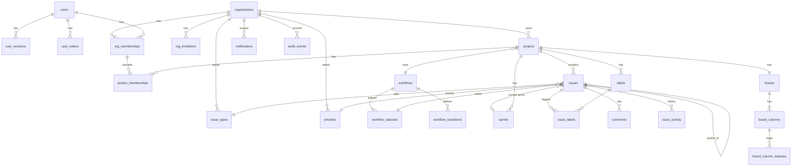

# Phase 1 — Target Architecture & MVP Design (Jira-like platform)

> **Verification status:** this document specifies intended design. A security property counts as verified only when its named test passes in CI. **Cross-tenant isolation is NOT verified**: it remains unverified until the M3 cross-tenant suite (R3.5) is implemented and passes. M0 verifies only runtime-role safety and tenant-context helper behavior. Words such as "enforced", "guarantees" or "impossible" below describe the design goal.

## Context
Phase 0 found the repo (`Anirudhani01/jira-project`) contains only `README.md` — no code, schema, or infra. This is a greenfield design. Approved decisions:
- **Stack:** React + TypeScript (frontend), Python + FastAPI (backend), PostgreSQL (data), Redis (rate limiting / cache).
- **Tenancy:** shared schema, `org_id` on every tenant-owned row, composite FKs, **Postgres Row-Level Security** as defense-in-depth.
- **Identity:** local email+password (Argon2id), server-side sessions in HttpOnly cookies, identity module shaped so OIDC/SAML can be added later.
- **Configurability:** workflows, statuses, transitions, issue types, priorities are **data**, seeded with defaults; limited editing UI in MVP; **no custom fields in MVP**.

Shape: **modular monolith** (one FastAPI API process + one worker process sharing the codebase). No microservices: no independent scaling or team-ownership need exists yet; module boundaries keep extraction possible later.

Legend: **[MVP]** in scope · **[LATER]** designed/deferred with justification · **[ASSUMPTION]** needs confirmation.

---

# REVISION 1 — Architecture review resolutions (supersedes any conflicting text in §1–§7)

> **Note (added in Revision 3):** further superseded items are listed in V3.2. Precedence: Rev 3 > Rev 2 > Rev 1 > base.
>
> **Note (added in Revision 2):** parts of R2, R3.2, R3.3 row 23, R5, R6, R7 and R9 are amended by Revision 2. See V2.2 for the conflict list. The R1 text below is preserved unchanged as history.

The approved stack and direction are unchanged. This revision fixes contract, isolation, concurrency and failure-mode gaps. Base sections below have been edited to match; where anything still conflicts, R-sections win.

## R1. Critical issues & proposed resolutions
| # | Issue found in Phase 1 draft | Sev. | Resolution |
|---|---|---|---|
| 1 | M1 signup returned 409 for duplicates (enumeration) | High | Uniform `202` from M1 onward, no auto-login, equal work on both paths (R2) |
| 2 | Pre-account-hijacking (attacker registers victim's email first) | High | Unverified accounts cannot create orgs or accept invitations; password reset marks email verified and revokes all sessions (R2) |
| 3 | Hard-deleting `org_memberships` forced user refs (reporter, author, actor) to point at global `users`, so DB could not prove same-tenant | High | Memberships are **soft-removed** (`removed_at`); every user reference in a tenant table is a composite FK `(org_id, user_id) → org_memberships` (R3) |
| 4 | `issues.status_id` single-column FK: a status from another workflow/tenant was insertable | High | `issues.workflow_id` + composite FKs tie status to the project's workflow in the DB (R3) |
| 5 | Global `users` table readable in full by `app_rw` | Med | RLS on `users`: self, or shares current org, or explicit auth-lookup setting; no global user search API (R3) |
| 6 | Last-owner check racy under concurrent demotions | High | Per-org mutex (`organizations` row `FOR UPDATE`) + deferred constraint trigger backstop (R4) |
| 7 | Raw email/invite tokens would sit in `outbox.payload` | Med | Payload holds IDs only; the worker mints the token at send time (R4) |
| 8 | Issue could be added to a sprint while it is being completed | Med | Sprint row lock protocol: completion `FOR UPDATE`, sprint assignment `FOR SHARE` + state check (R4) |
| 9 | Idempotency-key race undefined | Med | Insert key row first inside the business transaction; unique index serializes duplicates (R4) |
| 10 | Rank changes bumped `version`, causing spurious 412s on unrelated edits | Low | `rank` excluded from `version`; pure reorders need no `If-Match` (R4) |
| 11 | Key allocation locked the hot `projects` row | Low | Separate `project_issue_counters` table (R4) |
| 12 | Redis outage → login rate limits fail open | Med | Auth endpoints fall back to per-instance in-process limiter; `readyz` reports Redis as degraded but stays 200 (R5) |
| 13 | `projects.lead_user_id` speculative and an extra cross-tenant edge | Low | Removed from MVP |
| 14 | RLS presented as complete protection | Med | Trust boundaries, roles, and non-goals documented; catalog test enforces coverage (R3) |
| 15 | Missing tenant context could error (`''::uuid`) or leak via pooled connections | Med | `NULLIF` helper functions → fail closed; transaction-local settings + pool-leak test (R3) |
| 16 | Labels could be attached across projects | Med | `issue_labels` carries `project_id` with composite FKs (R3) |
| 17 | Board columns could map statuses from another workflow | Low | `boards.workflow_id` + composite FKs (R3) |

## R2. Authentication contract (resolves A)
**Public contract, fixed from M1 and never changed:**
- `POST /auth/signup {email, password, display_name}` → always `202 {"status":"accepted"}`, identical headers, **no session cookie**, for new, existing-verified, and existing-unverified emails.
- Both paths do equivalent work: validate → Argon2id hash the submitted password (even if discarded) → `INSERT … ON CONFLICT (email) DO NOTHING` (concurrent duplicate signups both get 202) → write audit `auth.signup.requested` (metadata never says which branch).
- Validation errors (bad email format, weak password) return 422 before any lookup — these reveal nothing about existence.
- Rate limits apply identically to both paths.
- `POST /auth/login` → `204` or generic `401 invalid_credentials`; unknown email runs a dummy Argon2 verify; unverified and verified users get identical responses (verification is enforced at the *action* level, not login).
- Password reset request → always `202`.

**M1 behavior (before email exists):**
- Account created **unverified**; no email is sent; UI copy for every outcome: "Request received. If you can sign in with these credentials, continue to sign in." (true for every branch).
- Unverified users can sign in and manage their account only. In M1 there is nothing else to do; from M3, creating an org and accepting an invitation require `email_verified_at`.
- Tests/dev fixtures set `email_verified_at` directly; no dev bypass endpoint exists.
- Config flag `SIGNUP_ENABLED` defaults to `false` when `ENVIRONMENT=prod` until M2 ships, so the M1 flow is never exposed publicly without email verification.

**M2 adds (same public contract):**
- New email → verification email. Existing verified email → "someone tried to register with your address; reset your password if this was you" email. Existing unverified → re-send verification (rate-limited, ≤3 active tokens).
- **[SUPERSEDED → V2.4/C3: reset revokes ALL sessions; verification rotates current + revokes others]** Verifying email or completing a password reset sets `email_verified_at` and **revokes all other sessions**. This defeats pre-registration hijacking: the attacker's unverified account could not create or join orgs, and the real owner's reset evicts the attacker.

## R3. Tenant isolation review (resolves B)

### R3.1 Database roles & trust boundaries
| Role | Used by | Attributes / grants |
|---|---|---|
| `app_owner` | Alembic migration job only | Owns schema; `NOSUPERUSER`; `LOGIN` only for the migration job; can `ALTER TABLE … DISABLE RLS`, so its credentials are fully trusted and never given to app/worker |
| `app_rw` | API processes | `NOSUPERUSER NOBYPASSRLS NOCREATEDB NOCREATEROLE`; DML on tenant tables via default privileges; **no** `UPDATE/DELETE` on `issue_activity`, `audit_events`; **only `INSERT`** on `outbox`; no `TRUNCATE`; no `CREATE` on schema |
| `app_worker` | Worker process | Same attributes as `app_rw`; `SELECT/UPDATE` on `outbox` (policy `TO app_worker`), `SELECT` on `users`, `INSERT/UPDATE` on `user_tokens`, tenant tables under tenant context |
| (later) `ops_readonly` | Humans, break-glass | Separate audited credentials; never the app's |

Postgres superuser is used only by provisioning (dev init script / IaC), never by app, worker, or migrations.

**Who can set tenant context:** only `app/db/tenant.py::bind_tenant(session, ctx)` (API request dependency, after membership verification) and `bind_job_context()` in the worker (from the outbox row). An architecture test fails if `set_config('app.` appears elsewhere in the codebase.

**What RLS protects against:** application queries that forget an `org_id` predicate, or load a row by a foreign ID, while running as `app_rw`/`app_worker` with correctly bound context.

**What RLS does NOT protect against (explicit non-goals):**
- SQL injection: any SQL running as `app_rw` can call `set_config('app.org_id', …)`. Defense is parameterized queries only (SQLAlchemy Core/ORM; raw `text()` with string interpolation is banned by lint rule + review).
- Compromised application code or stolen `app_rw` credentials (it can bind any tenant).
- A bug in membership resolution that binds the wrong org (tested directly, R3.5).
- `app_owner`/superuser access.
- Global tables without org scope (`user_sessions`, `user_tokens`), which are protected by module boundaries instead (R3.4).
- Timing/existence side channels via globally unique values: `organizations.slug` (inherent, accepted) and `users.email` (handled by R2).

**Fail-closed context:** helper functions `app_current_org()` / `app_current_user()` = `NULLIF(current_setting('app.org_id', true), '')::uuid`. With no context, policies compare to `NULL` → no rows visible, inserts rejected. Settings are bound with `set_config(…, true)` (transaction-local). Every request/job runs inside an explicit transaction. If `bind_tenant` is not called on a tenant route, the repository base raises before querying.

### R3.2 RLS policy templates
```sql
ALTER TABLE <t> ENABLE ROW LEVEL SECURITY; ALTER TABLE <t> FORCE ROW LEVEL SECURITY;
CREATE POLICY tenant_rw ON <t> TO app_rw, app_worker
  USING (org_id = app_current_org()) WITH CHECK (org_id = app_current_org());
```
Special cases:
| Table | Policy |
|---|---|
| `organizations` | SELECT: `id = app_current_org()` OR exists active membership with `user_id = app_current_user()`. INSERT: `WITH CHECK (id = app_current_org())` (app pre-generates the org id and binds it before insert). UPDATE: `id = app_current_org()` |
| `org_memberships` | SELECT: `org_id = app_current_org()` OR `user_id = app_current_user()` (list my orgs). Writes: template |
| `users` (global) | SELECT: `id = app_current_user()` OR exists membership `(m.user_id = users.id AND m.org_id = app_current_org())` OR `email = NULLIF(current_setting('app.auth_email', true),'')` (login/signup/reset lookup). INSERT: `true` (signup). UPDATE: `id = app_current_user()` |
| `org_invitations` | template OR (SELECT only) `token_hash = NULLIF(current_setting('app.invite_token_hash', true),'')::bytea` for the accept flow |
| `notifications` | SELECT/UPDATE/DELETE: `org_id = app_current_org() AND recipient_id = app_current_user()`. INSERT: `org_id = app_current_org()` |
| `idempotency_keys` | template AND `user_id = app_current_user()` |
| `audit_events` | SELECT: `org_id = app_current_org()` (NULL-org rows invisible to app roles). INSERT: `org_id IS NULL OR org_id = app_current_org()` |
| `outbox` | `app_rw`: INSERT `WITH CHECK (org_id IS NULL OR org_id = app_current_org())`, no SELECT. `app_worker`: `FOR ALL USING (true)`; worker then binds the job's org for any tenant-table access |
| `user_sessions`, `user_tokens` | No org scope (R3.4) |

### R3.3 Relationship matrix
Notation: **DB** = enforced by constraint; **Svc** = enforced in service code and covered by a test. Every tenant table carries `UNIQUE(org_id, id)` (plus wider uniques where listed) to be a composite-FK target. FK checks in Postgres bypass RLS, which is exactly why composite FKs are required.

| # | Relationship | Owner | FK (composite) | DB-enforced | Svc-enforced | Regression test |
|---|---|---|---|---|---|---|
| 1 | membership → org | org | `org_memberships.org_id → organizations(id)` RESTRICT | existence | — | RLS matrix |
| 2 | membership → user | global user | `user_id → users(id)` RESTRICT | existence | active = `removed_at IS NULL` | my-orgs lists only own |
| 3 | invitation.invited_by | org | `(org_id, invited_by) → org_memberships` | same-tenant inviter | inviter active + permission | FK-cross |
| 4 | project → workflow | org | `(org_id, workflow_id) → workflows(org_id,id)`; `UNIQUE(workflow_id)` | same tenant, 1 workflow per project | — | FK-cross |
| 5 | project_membership → project / org member | org | `(org_id, project_id) → projects(org_id,id)` CASCADE; `(org_id, user_id) → org_memberships` RESTRICT | same tenant | member must be active; org removal deletes project memberships in same tx | removal test |
| 6 | status → workflow | org | `(org_id, workflow_id) → workflows(org_id,id)`; `UNIQUE(workflow_id, id)` | same tenant | — | FK-cross |
| 7 | transition from/to → status | org | `(workflow_id, from_status_id)`, `(workflow_id, to_status_id) → workflow_statuses(workflow_id,id)` | same workflow | — | FK-cross |
| 8 | workflow.initial_status | org | `(id, initial_status_id) → workflow_statuses(workflow_id,id)` DEFERRABLE INITIALLY DEFERRED | same workflow | — | creation test |
| 9 | issue → project & workflow | org | `(org_id, project_id) → projects(org_id,id)`; `(org_id, project_id, workflow_id) → projects(org_id,id,workflow_id)` | issue's workflow = project's workflow | — | FK-cross |
| 10 | issue → status | org | `(workflow_id, status_id) → workflow_statuses(workflow_id,id)` | **status ∈ project workflow** | transition permitted | FK-cross + transition tests |
| 11 | issue → type / priority | org | `(org_id, type_id) → issue_types(org_id,id)`; `(org_id, priority_id) → priorities(org_id,id)` | same tenant | — | FK-cross |
| 12 | issue → parent | org | `(org_id, project_id, parent_id) → issues(org_id,project_id,id)`; `CHECK (parent_id <> id)` | same project, no self-parent | hierarchy levels (epic→standard→subtask; subtask needs parent; epic has none) ⇒ no cycles | hierarchy tests |
| 13 | issue → reporter | org | `(org_id, reporter_id) → org_memberships` RESTRICT | same tenant, history-stable | = acting principal | mass-assignment test |
| 14 | issue → assignee | org | `(org_id, assignee_id) → org_memberships` | same tenant | active + project member/admin role; unassigned on removal | assignee tests |
| 15 | issue → sprint | org | `(org_id, project_id, sprint_id) → sprints(org_id,project_id,id)` ON DELETE SET NULL (sprint_id) | same project | sprint not `closed` (lock protocol R4) | sprint tests |
| 16 | label → project; issue_label → issue & label | org | `labels(org_id, project_id) → projects`; `issue_labels(org_id, project_id, issue_id) → issues(org_id,project_id,id)` and `(org_id, project_id, label_id) → labels(org_id,project_id,id)` | **same project** | — | FK-cross |
| 17 | comment → issue / author | org | `(org_id, issue_id) → issues(org_id,id)`; `(org_id, author_id) → org_memberships` | same tenant | author = principal | FK-cross |
| 18 | activity → issue / actor | org | `(org_id, issue_id) → issues`; `(org_id, actor_id) → org_memberships` (nullable = system) | same tenant; append-only grants | written in same tx | grant test |
| 19 | board → project & workflow | org | `(org_id, project_id, workflow_id) → projects(org_id,id,workflow_id)`; `UNIQUE(project_id)` | same project & workflow | — | FK-cross |
| 20 | column → board; column_status → column/status | org | `board_columns(org_id, board_id) → boards(org_id,id)`; `board_column_statuses(board_id, column_id) → board_columns(board_id,id)`, `(board_id, workflow_id) → boards(id, workflow_id)`, `(workflow_id, status_id) → workflow_statuses(workflow_id,id)`; PK `(board_id, status_id)` | status from board's workflow, in ≤1 column | every status mapped (≥1) | board config tests |
| 21 | sprint → project | org | `(org_id, project_id) → projects(org_id,id)` | same tenant | — | FK-cross |
| 22 | notification → recipient / issue / actor | org | `(org_id, recipient_id)`, `(org_id, actor_id) → org_memberships`; `(org_id, issue_id) → issues(org_id,id)` | same tenant | recipient can view project | own-only test |
| 23 | audit_event → org / actor | org or platform | `org_id → organizations` nullable; `actor_user_id → users` (global; failed logins may lack membership) | — | org viewer requires `org.audit.view` | NULL-org invisible test |
| 24 | idempotency_key → member | org | `(org_id, user_id) → org_memberships` | same tenant | — | RLS matrix |
| 25 | outbox job | org or platform | `org_id → organizations` nullable | — | payload IDs only; worker binds tenant | worker isolation test |
| 26 | session/token → user | global | `user_id → users` CASCADE | — | identity module only | architecture import test |

`project_issue_counters(org_id, project_id PK, next_seq)` follows the template with `(org_id, project_id) → projects`.

### R3.4 Global tables
`users` (RLS as above), `user_sessions`, `user_tokens` (no org dimension). The sessions/tokens tables are accessed only by `modules/identity/repository.py` using token-hash lookups. An AST-based architecture test fails if any other module imports identity models. No endpoint exposes users outside shared-org context.

### R3.5 Cross-tenant regression suite (`backend/tests/security/`)
| Test | Asserts |
|---|---|
| `test_rls_catalog` | Every table with an `org_id` column has `relrowsecurity` and `relforcerowsecurity` and ≥1 policy. Every FK between two org-owned tables includes `org_id` in its column list (introspects `pg_constraint`). New tables fail CI until compliant. |
| `test_rls_matrix` | For each tenant table, as `app_rw` with org A bound: org B rows invisible; INSERT with B's `org_id` rejected; UPDATE/DELETE of B rows affects 0 rows |
| `test_rls_no_context` | No bound context → 0 rows on every tenant table, inserts rejected |
| `test_context_no_leak` | Two sequential transactions on the same pooled connection: second sees no context from first |
| `test_fk_cross_tenant` | Inserting A-rows referencing B's type, priority, status, workflow, parent, sprint, label, assignee, reporter, author, column fails with FK violation |
| `test_api_cross_tenant` | Every route, parametrized: user of A uses B's slugs/keys/ids → 404, DB checksum unchanged |
| `test_membership_resolution` | Removed member → 404; slug of other org → 404; case-variant slug resolves to the same org only |
| `test_runtime_roles` | API and worker DB roles are not superuser, not `BYPASSRLS`, not table owners; startup refuses otherwise outside dev |
| `test_worker_isolation` | A job bound to org A cannot read org B rows |
| `test_users_visibility` | Member list/API never returns users who share no org with the caller |
| `test_notifications_own_only` | Same-org user cannot read/mark another user's notifications |
| `test_set_config_confined` | `set_config('app.` appears only in `db/tenant.py` and worker binder |

## R4. Concurrency & consistency (resolves C)
Default isolation READ COMMITTED; `lock_timeout = 5s`, `statement_timeout = 10s` for API; the transaction commits before the response is serialized.

| Operation | Transaction boundary | Locking / mechanism | Constraint backstop | Regression test |
|---|---|---|---|---|
| **Last-owner protection** (demote/remove member, leave org) | One tx: lock → check → mutate → audit | `SELECT … FROM organizations WHERE id=:org FOR UPDATE` as a **per-org membership mutex**, then count active owners | Deferred constraint trigger on `org_memberships` (AFTER UPDATE/DELETE, INITIALLY DEFERRED) raising if org has 0 active owners at commit. It catches code paths that forget the lock, but is not race-proof alone. | Two connections concurrently demote the two owners of one org → exactly one succeeds, one gets 409 `last_owner` |
| **Issue key allocation** | Same tx as issue insert | `UPDATE project_issue_counters SET next_seq = next_seq+1 WHERE project_id=:p RETURNING next_seq`, executed as the **last step before INSERT** to keep the lock short. Row lock serializes creators per project. | `UNIQUE(project_id, seq)` | 50 concurrent creates → keys 1..50, no duplicates; a create that fails validation after allocation rolls back and does not consume a number |
| — meaning of "gap-free" | | Numbers are consumed only by committed creates (counter update rolls back with the tx). Soft-deleted issues keep their number. **Numbers are never reused**; gaps can appear only if issues are hard-purged (post-MVP) or the project is restored from partial backup. The contract promises "unique, increasing, never reused", not "no holes forever". | | |
| **Issue update (PATCH)** | One tx | Read current row → compute diff → `UPDATE … SET …, version=version+1 WHERE org_id=:o AND id=:id AND version=:v RETURNING *`; 0 rows ⇒ 412. Activity rows from the diff (valid because the version matched). `If-Match` required (428 if missing). | — | Stale `If-Match` → 412, no row/activity change; concurrent PATCHes with same version → exactly one 200 |
| — what bumps `version` | | summary, description, type, priority, assignee, status, parent, labels, sprint. **Not** `rank` (reorder is last-write-wins; ties broken by id) | | Reordering does not invalidate an open edit form |
| **Workflow transition / board move** | One tx | Load issue + transition (workflows are read-only in MVP, so no definition race). `UPDATE … WHERE id=:id AND version=:v AND status_id=:from`. Status, rank, sprint and version change in one statement; activity + notifications in same tx. | FK (workflow_id, status_id) | Disallowed transition → 422, nothing written; concurrent transitions with same version → one wins, other 412 |
| **Sprint start** | One tx | `SELECT sprint FOR UPDATE`; require `future` | partial UNIQUE (project_id) WHERE state='active' → 409 | Two concurrent starts in one project → one 409 |
| **Sprint completion & carry-over** | One tx | `SELECT sprint FOR UPDATE` (must be `active`); lock target sprint `FOR UPDATE` (must be `future`, same project). `UPDATE issues SET sprint_id=:target, version=version+1 WHERE sprint_id=:s AND status category <> done AND deleted_at IS NULL RETURNING id, version`; `INSERT … SELECT` activity; set sprint `closed`. **Any operation assigning an issue to a sprint takes `SELECT sprint FOR SHARE` and requires state ≠ closed**, so it serializes against completion. | FK + state CHECK | Concurrent "add issue to sprint" during completion → either carried over or rejected with 409, never left in a closed sprint; double-complete → 409 |
| **Idempotency keys** | Same tx as the business operation | First statement: `INSERT INTO idempotency_keys (…, status='pending', request_hash) ON CONFLICT DO NOTHING RETURNING`. A concurrent duplicate blocks on the unique index until the first commits, then sees the row: same hash → replay stored response; different hash → 422 `idempotency_key_reused`. If the first rolls back, the waiter proceeds as the original. Waiting is bounded by `lock_timeout` → 409 `idempotency_in_progress` (retryable). Only successful (2xx) responses are stored; 4xx roll back the key. TTL 24 h, purged by job. | PK (org_id,user_id,key) | Two parallel identical POSTs → one issue, both responses identical; same key/different body → 422 |
| **Outbox enqueue** | Same tx as the business change | `INSERT` only; nothing sent before commit | — | Rolled-back request leaves no outbox row |
| **Outbox delivery (at-least-once)** | Claim tx → process outside tx → ack tx | Claim: `UPDATE outbox SET locked_until=now()+'5 min', attempts=attempts+1 WHERE id IN (SELECT id … WHERE processed_at IS NULL AND dead_at IS NULL AND available_at<=now() AND (locked_until IS NULL OR locked_until<now()) ORDER BY id LIMIT 20 FOR UPDATE SKIP LOCKED) RETURNING *`. Ack: `processed_at=now()`. A crash before ack → lease expires → redelivery. | — | Kill worker between send and ack → job redelivered once lease expires; two workers never process the same job concurrently |
| — handler idempotency | | DB-effect handlers write effects and `processed_at` in **one** tx (exactly-once effect). Email handlers are at-least-once: pass the outbox id as provider idempotency key / `Message-ID` where the provider supports it. Token-minting jobs keep earlier unexpired tokens valid (max 3 active per user/purpose), so a duplicate email never breaks the first link. | | Duplicate verification emails both work; DB-effect job replay produces no duplicate rows |
| **Org & project creation** | One tx each | Pre-generated ids; all seeded rows (types, priorities, workflow clone, board, columns, counter, creator membership) inserted together | Deferred FKs where circular | Fault injection mid-creation → nothing persisted |
| **Member removal** | One tx | Org mutex; set `removed_at`; delete project memberships; unassign issues (bump version + activity); revoke pending invitations they sent? (no, invitations remain valid; audited) | Composite FKs | Removed user loses access immediately; their issues unassigned with activity |

## R5. Operational failure modes (resolves D)
| Failure | Expected behavior |
|---|---|
| **Redis unavailable** | General API rate limiting **fails open** (request proceeds; `ratelimit_backend_errors_total` metric + error log, alert after 1 min). **Auth endpoints** (login, signup, reset, verification resend, invitation accept) switch to a per-instance in-process sliding-window limiter with the same limits: weaker across instances but never unlimited. `/readyz` returns 200 with `{"redis":"degraded"}` so instances are not pulled from the load balancer for a non-critical dependency. No caches in MVP, so no stale-data risk. Sessions are in Postgres, so login state is unaffected. |
| **PostgreSQL unavailable** | Requests needing the DB → `503 problem+json code=service_unavailable` with `Retry-After`. No anonymous fallback: session lookup failure is never treated as "logged out". `/readyz` → 503 (instance drained); `/healthz` stays 200 (no restart storm). Pool: `pool_pre_ping`, connect timeout 5 s. Worker: exponential backoff with jitter, no job state changes. Frontend: TanStack Query retries **GETs only** (3×, backoff); mutations surface an error with retry button. |
| **Transaction fails during commit** | Constraint/deferred-trigger violation at commit → mapped to 409/422 with no partial effects. Serialization/deadlock error → automatically retried up to 3× **only for idempotent-safe operations** (those with `If-Match` or `Idempotency-Key`); otherwise 409 `retryable_conflict`. Connection lost during `COMMIT` → outcome unknown → `503 code=commit_outcome_unknown`; clients retry safely because creates carry `Idempotency-Key` (replay or create) and updates carry `If-Match` (412 if it already committed → refetch). No 2xx is ever returned before commit succeeds; no external side effect happens before commit (emails go through the outbox). |
| **Worker crashes after processing, before ack** | Lease expires (5 min) → job redelivered. Effects are idempotent per R4 (DB effects exactly-once; emails possibly duplicated, both valid). |
| **Job repeatedly fails** | Backoff `min(6h, 1m·5^(attempt-1))` + jitter; after 10 attempts set `dead_at`, keep `last_error` (no secrets). Metric `outbox_dead_total` + alert. CLI: `python -m app.cli outbox list-dead / requeue <id>`. Poison jobs never block others (`SKIP LOCKED`, per-row processing). |
| **Migration fails partway** | Alembic `transaction_per_migration=True`; Postgres transactional DDL rolls back the failed revision completely. Migrations set `lock_timeout='5s'` to avoid stalling traffic. Non-transactional steps (`CREATE INDEX CONCURRENTLY`) live in their own revision with an autocommit block, `IF NOT EXISTS`, and a documented cleanup for an `INVALID` index. Deploy order: migration job → app rollout; a failed migration halts the deploy and the old app keeps running (expand/contract keeps old code compatible with schema N+1). Recovery is **roll-forward first**; `downgrade` is tested in CI; PITR backup snapshot before any data-rewriting migration. |
| **Email provider outage** | Jobs retry per backoff; user-facing flows already returned 202; user can request resend. |
| **Clock skew** | Token/session expiry evaluated with DB `now()`, not app clocks. |

**Security fail-open vs fail-closed decisions**
| Control | Mode | Rationale |
|---|---|---|
| Config validation at startup | **Closed** (refuse to start) | Unsafe defaults must never run in staging/prod |
| Session lookup error | **Closed** (503) | Never downgrade to anonymous |
| Membership/permission resolution error | **Closed** (503/404) | Authz never assumed |
| Missing tenant context | **Closed** (RLS returns nothing; repo raises) | Isolation invariant |
| CSRF / Origin check | **Closed** | |
| Auth-endpoint rate limiting | **Degraded-closed** (local fallback limiter) | Brute force must stay bounded |
| General API rate limiting | **Open** + alert | Availability over abuse limits for authenticated users |
| Audit write for security-sensitive mutations | **Closed** (same tx; action fails if audit fails) | No unaudited privileged change |
| Audit write for failed login **[SUPERSEDED → applies to platform security events, V2.7/V3.2]** | **Open** (log + metric) | Prevent audit outage from blocking all logins; failures still logged |
| Email send | **Open** (async retry) | User flows not blocked |

## R6. Assumptions that materially affect architecture, security, cost or scope
| Priority | Assumption | Affects | Decide before |
|---|---|---|---|
| P0 | Toolchain pins: Python 3.13, Node 24 LTS, pnpm 10, uv, Postgres 17, Redis 7 | Reproducibility, CI images | **M0** |
| P0 | Production DB will be a managed Postgres that allows custom roles, RLS, `citext`, and transaction-local settings (no statement-level pooling) | Whole isolation design | **M0** |
| P0 | No public deployment before M2 (`SIGNUP_ENABLED=false` in prod) | Signup exposure | **M0** (config default) |
| P1 | Open self-signup (vs invite-only/admin-provisioned) | Signup endpoint existence, abuse surface, rate-limit cost | **M1** |
| P1 | Login allowed while unverified; verification enforced at org create / invite accept | Pre-hijack defense, UX | **M1** |
| P1 | Session TTLs: idle 24 h, absolute 14 d; no "remember me" | Security posture, enterprise policy | **M1** |
| P1 | **[SUPERSEDED → D3/D7]** Password policy: 12–128 chars, no composition rules, no breached-password check in MVP (offline list or HIBP later) | Security, external dependency | **M1** |
| P1 | MFA not in MVP; session model leaves room for `mfa_verified_at` | Enterprise readiness | **M1** |
| P2 | Org slugs globally unique and visible in URLs (existence leak on create accepted) | URL design | **M3** |
| P2 | Single region, no data-residency requirement | Hosting cost, schema (no region sharding) | **M3** |
| P2 | Audit retention 1 year; platform-level (NULL-org) events visible only to operators | Storage cost, compliance | **M3** |
| P2 | Transactional email provider supports idempotency keys or tolerates duplicates | Delivery semantics | **M2** |
| P3 | Members can create projects; viewers can't comment or be assigned | Policy table | **M5/M7/M8** |
| P3 | Attachments deferred to 1.1 | Infra cost (object storage, scanning) | **Before 1.1 planning** |
| P3 | Polling instead of realtime | Infra (no WebSocket tier) | **M9** |
| P3 | Scale numbers in §1.4 | Index design, worker counts, cost | **M12** (load test) |

## R7. Updated acceptance criteria (affected milestones)
- **M0:** see R9 checklist. In addition: the runtime DB role is verified non-owner/non-bypass by test; `make ci` locally runs exactly the CI steps; migration round-trip passes on empty DB; the helper functions `app_current_org()` / `app_current_user()` exist and return NULL without context.
- **M1:** signup always 202 with no cookie for new/duplicate/unverified (byte-identical body, same headers), verified by test; concurrent duplicate signups both 202 with one row; signup and login median latency within 20% between existing/non-existing emails (statistical test, generous bound); login generic 401; unverified users can log in but `email_verified_at` is NULL; `SIGNUP_ENABLED=false` → 404 on signup; session cookie flags; CSRF enforced; auth rate limits hold with Redis stopped (fallback limiter test); audit events written.
- **M2:** three signup branches send the three distinct emails while API responses stay identical; verify/reset tokens single-use, hashed, expiring, ≤3 active; reset and verification set `email_verified_at` and revoke all other sessions; outbox payloads contain no tokens or passwords (test scans payloads); worker crash-before-ack redelivers; dead-letter after 10 attempts with CLI requeue.
- **M3:** all R3.5 tests present and green (`test_rls_catalog` gates every later migration); unverified user cannot create an org (403 `email_unverified`); org creation binds the pre-generated id; users RLS limits visibility; NULL-org audit rows invisible.
- **M4:** concurrent last-owner test; soft removal (`removed_at`) with immediate loss of access, project memberships deleted, issues unassigned (from M6 on) in same tx; invitation accept requires verified matching email; invite tokens minted by worker only.
- **M5:** composite FKs per matrix rows 4–8, 19–20; board column mapping rejects statuses from other workflows at DB level; creation atomicity fault-injection test; counter row created with project.
- **M6:** gap/uniqueness test with 50 concurrent creates; failed create doesn't consume a number; PATCH 428/412 semantics; rank changes don't bump version; idempotency race test; activity atomicity; FK-cross tests for type/priority/status/reporter.
- **M7:** status-in-workflow enforced by FK; hierarchy tests; `issue_labels` cross-project rejection at DB level; assignee active-member+role rule.
- **M10:** sprint start/complete concurrency tests; add-during-completion test; carry-over bumps version and writes activity.
- **M11:** notifications own-only RLS test; recipients exclude actor and users without project view.

## R8. Remaining risks & unresolved product decisions
**Risks (accepted or monitored)**
| Risk | Mitigation / status |
|---|---|
| RLS policy subqueries (`users`, `organizations`) add query cost | Indexes on `org_memberships(user_id, org_id)`; `EXPLAIN` checks in M3; revisit if p95 regresses |
| RLS does not stop SQLi or a compromised app | Parameterized-only rule, lint, review, least-privilege roles; documented non-goal |
| Per-project issue creation serialized by counter lock | Acceptable at assumed scale (short lock); measured in M12 load test |
| Local fallback limiter is per instance (N× attempts during Redis outage) | Bounded and alerted; acceptable for outage windows |
| Duplicate emails under at-least-once delivery | Provider idempotency where supported; both links valid |
| Org slug existence observable | Accepted (inherent to slug URLs) |
| Soft-removed memberships accumulate | Negligible volume; enables history integrity |
| No MFA/SSO in MVP limits enterprise adoption | Planned post-MVP; session schema extensible |
| Unknown production platform | Containerized, 12-factor; platform chosen before M12 |

**Unresolved product decisions (owner: you)**
1. Open self-signup vs invite-only (before M1).
2. Session timeouts and whether "remember me" exists (before M1).
3. Breached-password checking in MVP (before M1).
4. Org slug in URLs vs opaque org IDs (before M3).
5. Audit retention and operator visibility of platform events (before M3).
6. Can org members create projects? Can viewers comment / be assigned? (before M5/M7/M8)
7. Attachments in MVP or 1.1 (before M8).
8. Deployment platform, region, email provider (before M12; email provider before M2 prod use).

## R9. Final M0 implementation checklist
**Repository & reproducibility**
- [ ] Layout: `backend/`, `frontend/`, `infra/`, `docs/adr/`, `.github/`; `Makefile` targets `dev`, `down`, `test`, `lint`, `typecheck`, `fmt`, `migrate`, `migrate-roundtrip`, `openapi`, `audit`, `secrets-scan`, **`ci`** (runs the exact CI sequence locally)
- [ ] Toolchain pins: `.python-version` (3.13), `uv.lock`; `.nvmrc` (24), `packageManager: pnpm@10.x` + `pnpm-lock.yaml`; Docker images pinned by version tag (`postgres:17.x`, `redis:7.x`)
- [ ] `.gitignore`, `.editorconfig`, `.env.example` (placeholders only), README with one-command setup

**Database & migrations**
- [ ] `infra/postgres/init/01-roles.sql`: creates `app_owner`, `app_rw`, `app_worker` with R3.1 attributes; `REVOKE CREATE ON SCHEMA public FROM PUBLIC`; used by docker-compose **and** CI service setup
- [ ] Alembic connects with `MIGRATION_DATABASE_URL` (`app_owner`); `transaction_per_migration=True`; migration-level `lock_timeout`
- [ ] Baseline revision: `citext` extension; `app_current_org()` / `app_current_user()` helpers (infrastructure for all later RLS, justified in M0); `ALTER DEFAULT PRIVILEGES FOR ROLE app_owner` granting DML to `app_rw`/`app_worker`. **No domain tables.**
- [ ] `make migrate-roundtrip`: upgrade head → downgrade base → upgrade head on an empty DB

**Backend**
- [ ] `create_app()`; `core/config.py` (pydantic-settings): required vars, `ENVIRONMENT`; outside dev, refuse to start if `COOKIE_SECURE=false`, DB URL user equals migration user, or required secrets missing/placeholder (**[SUPERSEDED → V3.2]** `SIGNUP_ENABLED` validation moves to M1)
- [ ] Startup check (non-dev): runtime DB role not superuser / not BYPASSRLS / not owner
- [ ] Stdlib JSON logging formatter (no extra dep); request-ID middleware (accept a valid inbound `X-Request-ID` or generate; echo in response; bind to log context); redaction filter for `password|token|secret|cookie|authorization`
- [ ] problem+json handlers: HTTPException, RequestValidationError (field errors), unhandled → 500 without stack, always `request_id`
- [ ] Security headers middleware; request body limit 1 MB → 413
- [ ] Async engine (`asyncpg`, `pool_pre_ping`, connect timeout, `statement_timeout`), session helper with explicit commit; `db/tenant.py` stub `bind_tenant()` (transaction-local `set_config`), not yet used by routes
- [ ] `/healthz` (process only) and `/readyz` (DB `SELECT 1` required → 503 on failure; Redis `PING` → `degraded`, still 200); OpenAPI docs only in dev; `openapi.json` exported by `make openapi`
- [ ] Tooling: ruff (lint + format), mypy (strict for `app/`), pytest + pytest-asyncio + httpx

**Frontend**
- [ ] Vite + React + TS strict; React Router with AppShell, NotFound, route error boundary; TanStack Query provider (GET retries only); `lib/api/client.ts` with problem+json → `ApiError`; Tailwind
- [ ] eslint + prettier + `tsc --noEmit`; Vitest + Testing Library; `pnpm build` succeeds

**CI / supply chain**
- [ ] `.github/workflows/ci.yml` calls the same `make` targets: backend (lint, typecheck, tests with Postgres+Redis services initialized via `01-roles.sql`, migration round-trip, OpenAPI drift), frontend (lint, typecheck, test, build), gitleaks, `pip-audit`, `pnpm audit --audit-level=high`
- [ ] `.github/dependabot.yml` for pip/uv, npm, GitHub Actions, Docker
- [ ] Containers: multi-stage, non-root user; backend image runs uvicorn; frontend image served by nginx with SPA fallback + `/api` proxy (same-origin)

**Tests in M0**
- [ ] healthz 200; readyz 503 when DB down; readyz 200 + degraded when Redis down
- [ ] Unhandled exception → problem+json 500 with `request_id`, no stack; validation → 422 field errors; 413 on oversize body; headers present
- [ ] Request ID generated/propagated; invalid inbound ID replaced
- [ ] Config: insecure prod config rejected; dev config accepted
- [ ] Roles: `app_rw` cannot `CREATE TABLE`; is not superuser/BYPASSRLS; helpers return NULL without context and the bound value with context, and context does not survive the transaction
- [ ] Migration round-trip
- [ ] Frontend: shell renders; unknown route → NotFound; `ApiError` parsing

**Docs**
- [ ] ADRs 0001–0007: modular monolith; stack; shared schema + RLS (incl. R3.1 trust boundaries); local auth + server sessions + enumeration-safe contract (R2); data-driven workflows; API conventions; failure-mode policy (R5)

**Explicitly out of M0:** domain tables, auth endpoints, worker process, outbox, rate limiter, cloud deployment, E2E tests.

---

# REVISION 2 — Confirmed decisions D1–D5 (amends Revision 1; R1 text preserved as history)

Approved architecture unchanged: React + TypeScript + Vite frontend; FastAPI modular monolith + separate worker; PostgreSQL shared schema with RLS; Redis for rate limiting; Argon2id + server-side sessions; data-driven workflows; polling in MVP (WebSockets remain a LATER capability). M0 stays free of domain tables and authentication features.

## V2.1 Decision log
| ID | Decision | Status | Date | Source |
|---|---|---|---|---|
| A1 | Stack: React + TS + Vite / Python + FastAPI / PostgreSQL / Redis | Approved | Phase 1 | User answer |
| A2 | Modular monolith + separate worker; no microservices | Approved | Phase 1 review | User review |
| A3 | Shared schema + `org_id` + composite FKs + Postgres RLS | Approved | Phase 1 | User answer |
| A4 | Local auth (Argon2id), server-side sessions, OIDC-ready | Approved | Phase 1 | User answer |
| A5 | Data-driven workflows/types/priorities, seeded defaults, no custom fields in MVP | Approved | Phase 1 | User answer |
| A6 | Polling in MVP; WebSockets later | Approved | Rev 2 | Final check 6 |
| **D1** | Open self-signup; enumeration-safe responses; prod signup disabled until M2; verification required for org creation & invitation acceptance | **Approved** | Rev 2 | Decision D1 |
| **D2** | Sessions: idle 24 h, absolute 14 d, no Remember Me, Secure + HttpOnly + SameSite=Lax, rotation at auth boundaries, logout revokes current, reset revokes all | **Approved** | Rev 2 | Decision D2 |
| **D3** | Breached-password screening (Pwned Passwords k-anonymity range API + local denylist) at every password set | **Approved** | Rev 2 | Decision D3 |
| **D4** | Readable org slugs in routes; immutable internal UUIDs; slugs never authorize; uniform 404 for inaccessible; slug rename deferred | **Approved** | Rev 2 | Decision D4 |
| **D5** | Org audit retention 1 year, owners/admins only; platform security events separated; operators get no default access to customer content; secrets never recorded; separate policies per data class | **Approved** | Rev 2 | Decision D5 |

## V2.2 Conflicts with Revision 1 (identified, not silently resolved)
| # | Revision 1 text | Conflicting decision | Proposed resolution (applied in Rev 2 spec) | Needs your confirmation? |
|---|---|---|---|---|
| C1 | R6 P1 row and R8 #3: "no breached-password check in MVP" | D3 requires screening | D3 supersedes. M1 gains a breach-check module, `httpx` becomes a runtime dependency, and production needs outbound HTTPS egress to `api.pwnedpasswords.com` | No |
| C2 | R3.2/R3.3 row 23: `audit_events.org_id` nullable, holding platform events; R5 row "Audit write for failed login"; R7-M3 "NULL-org audit rows invisible"; §4.4 lists `auth.*` events as audit events | D5 requires separate access control for platform security events | Split into two stores: **`audit_events`** (org-scoped, `org_id NOT NULL`, owners/admins) and **`platform_security_events`** (global, separate schema/role, never readable by `app_rw`). `auth.*` events move to platform security events. The R5 failed-login fail-open rule now applies to platform security events | No |
| C3 | R2: "Verifying email or completing a password reset … revokes all **other** sessions" | D2: reset revokes existing sessions per documented policy | Reset revokes **all** sessions and does not auto-login. Email verification revokes all *other* sessions and rotates the current one | No (clarification) |
| C4 | R2/M2 implied token links as query strings | D5: never record reset tokens | Email links carry tokens in the **URL fragment** (`/reset-password#token=…`), which browsers never send to servers, so tokens stay out of nginx/app logs and Referer. Token pages set `Referrer-Policy: no-referrer` | No |
| C5 | R2: "no dev bypass endpoint exists" | D1: document dev/test handling | Kept: no HTTP bypass. Added a **dev/test-only CLI** (V2.3) that refuses to run unless `ENVIRONMENT ∈ {dev, test}` | No |
| C6 | §1.3 FR-ORG "create/rename org" | D4: slug rename deferred | "Rename" means display name only; `slug` is immutable in MVP | No |
| C7 | §4.1/R1 had no limit on concurrent sessions | D2: test concurrent session behavior | Define a cap of **20 active sessions per user**; creating the 21st revokes the least-recently-used | **Yes** (value) |
| C8 | R9 M0 logging: denylist redaction filter only | D5: never record secrets | M0 logging becomes **allowlist-based** (only named fields logged); the redaction filter stays as a backstop. Still no auth features in M0 | No |
| C9 | R5 has no stated behavior for an external breach-check outage | D3: define fallback | Fail open to the **local denylist only** (V2.5), with metric + alert | **Yes** (fail-open vs fail-closed) |

## V2.3 D1 — Signup policy (refines R2)
- Public contract unchanged from R2: `POST /auth/signup` → always `202 {"status":"accepted"}`, no cookie, identical for new/existing/unverified emails. Breached or weak passwords → `422 password_rejected` **before** any account lookup (reveals nothing about existence).
- Order of work on every path: schema validation → denylist → Pwned Passwords range check → Argon2id hash → `INSERT … ON CONFLICT (email) DO NOTHING` → platform security event → (M2+) outbox job.
- Email verification (`email_verified_at`) is required for `POST /orgs` and `POST /invitations/accept` → otherwise `403 email_unverified`. Login and account management do not require it.
- **Environment behavior before M2 (no email delivery):**

| Environment | `SIGNUP_ENABLED` | How verification happens |
|---|---|---|
| prod | `false` (startup validation rejects `true` while `EMAIL_DELIVERY_ENABLED=false`) | n/a |
| staging | `true` only if staging is access-restricted (VPN/IP allowlist/basic auth at proxy) [ASSUMPTION] | dev CLI unavailable; staging waits for M2 for verified flows |
| dev | `true` | `python -m app.cli users verify <email>` (refuses outside dev/test, writes a platform security event `user.verified_by_cli`) |
| test | `true` | Factories set `email_verified_at`; E2E uses Mailpit from M2, CLI before M2 |
- From M2: Mailpit (dev/E2E) captures verification/reset/invite emails; the CLI remains for local convenience only.

## V2.4 D2 — Session policy (refines §4.1 / R2)
| Aspect | Policy |
|---|---|
| Token | 32 random bytes; cookie stores the raw token; DB stores SHA-256 only |
| Cookie | prod/staging: `__Host-session`; `Secure; HttpOnly; SameSite=Lax; Path=/`; no `Domain`. dev on `http://localhost`: name `session`, `Secure` off — allowed only when `ENVIRONMENT=dev` (startup validation) |
| Lifetime | Idle 24 h (sliding on `last_seen_at`), absolute 14 d from creation; both evaluated with DB `now()`. No Remember Me |
| `last_seen_at` writes | Throttled: updated at most once per 5 min per session (avoids write contention), so effective idle timeout = 24 h + ≤5 min |
| Rotation at boundaries | **Login:** always a new session (no pre-auth session exists). **Password change:** current session replaced by a new token, all others revoked. **Email verification:** current rotated, others revoked. **Password reset:** all sessions revoked, no auto-login. **Privilege changes** (role changes): no rotation needed, because authz is evaluated server-side per request. **Future MFA/SSO:** rotate on step-up |
| Logout | Revokes the current session (`revoked_at`), clears the cookie; idempotent |
| User-initiated revoke | `DELETE /me/sessions/{id}` for own sessions; "revoke all others" endpoint `POST /me/sessions/revoke-others` |
| Concurrency | Unlimited parallel requests per session. Revocation takes effect for requests that **start** after the revoking transaction commits. Cap of 20 active sessions per user (C7): the 21st login revokes the least-recently-used in the same transaction |
| CSRF | Per-session token, rotated with the session |
| Disabled user | All sessions rejected at lookup |
| Cleanup | Expired/revoked sessions purged after 30 days (worker periodic job, M12) |

## V2.5 D3 — Breached-password screening
- **Where:** signup (M1), password change (M1), password-reset confirm (M2). Login does not re-check in MVP (LATER: check on login and force a change).
- **Local denylist (always on):** bundled list of the most common 100k passwords (permissively licensed source; license recorded in repo) loaded into a `frozenset` at startup; compare case-insensitively. Also reject passwords equal to or containing the email local part, display name, or product name (case-insensitive).
- **Pwned Passwords range check:** compute SHA-1 of the password in memory; send **only the first 5 hex characters** to `GET https://api.pwnedpasswords.com/range/{prefix}` with header `Add-Padding: true` and a descriptive `User-Agent`; compare suffixes locally; reject if count ≥ 1. The plaintext and the full hash never leave the process and are never logged. No API key is needed for the range endpoint.
- **Client:** `httpx.AsyncClient` with timeout 2 s total (connect 1 s), no retries (latency budget), connection pooling, TLS verification on.
- **Failure behavior (C9, proposed):** timeout, 5xx, 429 or network error → **fail open to the local denylist only**. The password is accepted if it passes the denylist and length rules; emit `breach_check_unavailable_total` metric (alert at sustained >5% of checks over 10 min); record `breach_check: "unavailable"` in the platform security event metadata (no password data). Alternative fail-closed (reject signups during outage) needs your confirmation if preferred.
- **Config:** `BREACH_CHECK_MODE = hibp | local_only` (`local_only` is permitted only in dev/test; prod/staging require `hibp`), `HIBP_BASE_URL`, `HIBP_TIMEOUT_MS`.
- **Response:** `422 {"code":"password_rejected","errors":[{"field":"password","message":"This password has appeared in a data breach or is too common. Choose a different password."}]}`. The same message is used for denylist and breach hits.
- **Hashing:** Argon2id unchanged (`argon2-cffi`), with parameters recorded in the ADR.
- **Tests:** known breached password (mocked range response containing its suffix) → 422; acceptable password → accepted; denylisted password with HIBP mocked as clean → 422; HIBP timeout / 503 / connection error → accepted if denylist passes, with metric incremented; request sends only a 5-char uppercase hex prefix and the `Add-Padding` header (asserted via `httpx.MockTransport`); captured logs and platform events contain neither the password nor its hash; no live network in CI (mock transport).

## V2.6 D4 — Organization URLs
- Routes: frontend `/o/:org`, API `/api/v1/orgs/{org_slug}/…`; slug `^[a-z0-9][a-z0-9-]{1,38}$`, case-insensitive unique, **immutable in MVP**. A reserved list (`api, admin, app, auth, login, logout, signup, o, orgs, new, settings, account, invitations, static, assets, health, status, support, help, docs, www`) is enforced at creation.
- `organizations.id` (UUID) is the immutable internal identifier. All foreign keys, RLS context, cache keys, logs and audit use the UUID, never the slug.
- Slug → UUID resolution happens once per request **through the caller's active membership**. Unknown slug, removed membership, and no membership all produce the identical `404 {"code":"not_found","title":"Not found"}` (same body shape and headers for every inaccessible resource type; no resource-type-specific wording).
- Authorization never depends on knowing a slug, issue key or UUID. Every request re-checks membership and permissions server-side (R3, §4.2).
- Accepted residual: `POST /orgs` with a taken slug returns `409 slug_unavailable` (inherent to unique slugs; rate-limited per user).
- Slug rename and redirects: LATER, via a `organization_slug_history` table.

## V2.7 D5 — Audit, security events and logs: retention, deletion, access
**Data classes**
| Class | Store | Contents | Retention | Deletion mechanism | Access |
|---|---|---|---|---|---|
| **Org audit events** | `public.audit_events` (`org_id NOT NULL`, RLS, append-only for `app_rw`) | Org-scoped administrative actions (§4.4 list minus `auth.*`), actor, target, outcome, request_id, allowlisted metadata | **1 year** | Daily batched purge by role `app_retention` (DELETE on this table only) via worker periodic job; monthly partitioning LATER if volume requires | Org **owners/admins** via `GET /orgs/{org}/audit-events` (`org.audit.view`). Not other members. Platform operators: no app access; DB access only via audited break-glass |
| **Platform security events** | `security.platform_security_events` (separate schema). `app_rw`/`app_worker`: INSERT only, no SELECT | Signup requests, login success/failure, logout, password change/reset, session revocations, email verification, CLI verifications, rate-limit trips, breach-check outages, startup security-check failures. Fields: user_id (if known), **HMAC-SHA256(email, server key)** for unknown-email attempts (correlation without storing raw addresses), IP, UA, outcome, reason code | **1 year [proposed]** | Daily purge by `app_retention` | Role `platform_security_reader` (security team), via SQL/SIEM export. **Not** exposed to org admins in MVP |
| **Application logs** | stdout → log platform | Allowlisted request metadata (method, route template, status, duration, request_id, org_id, user_id), errors with stack traces. **No request/response bodies, no query strings on auth routes, no headers except allowlisted** | **30 days [proposed]** | Log platform TTL | Platform operators / on-call |
| **Traces & metrics** | OTel backend | Spans with route templates and ids; no bodies or attribute values from user content | Traces 14 days, metrics 13 months [proposed] | Backend TTL | Platform operators |
| **Issue activity** | `issue_activity` (tenant data, not audit) | Field history incl. user content | Lifetime of the issue | With issue purge (LATER) | Users with `project.view` |

**Never recorded anywhere** (audit metadata, security events, logs, traces, outbox payloads, error reports): passwords (any field), password hashes, session tokens, cookies / `Set-Cookie`, `Authorization` headers, CSRF tokens, verification/reset/invitation tokens, raw request bodies of `/auth/*`, `/me/password`, `/invitations/accept`. Enforcement:
1. Allowlist logging (only named fields are emitted).
2. Per-action metadata allowlist for audit/security events (schema-validated).
3. Redaction filter as a backstop.
4. Tokens travel in URL fragments (C4).
5. nginx access-log format excludes query strings and cookies.
6. Test: run all auth flows with log/event capture and assert that none of the known secret values appear.

**Operator access to customer content:** platform roles (`platform_security_reader`, on-call) have no grants on tenant tables. Production DB access to tenant data requires break-glass credentials (ticket reference, time-boxed, session logged). Logs and traces contain no issue/comment content by construction.

**Org lifecycle:** org deletion is not in the MVP; behavior of audit events after org deletion is an open question (V2.10).

## V2.8 Updated prioritized assumptions (replaces R6 for current status)
| Priority | Item | Status | Decide before |
|---|---|---|---|
| P0 | Toolchain pins (Python 3.13, Node 24 LTS, pnpm 10, uv, Postgres 17, Redis 7) | Assumed | M0 |
| P0 | Managed Postgres supports custom roles, RLS, `citext`, multiple schemas, transaction-local settings | Assumed | M0 |
| P0 | Prod signup off until M2 | **Decided (D1)** | — |
| P1 | Open self-signup | **Decided (D1)** | — |
| P1 | Verification gates org creation & invite acceptance only | **Decided (D1)** | — |
| P1 | Session TTLs 24 h / 14 d, no Remember Me | **Decided (D2)** | — |
| P1 | Concurrent-session cap = 20, LRU eviction | **Proposed (C7)** | M1 |
| P1 | Breached-password screening | **Decided (D3)** | — |
| P1 | Breach-check outage → fail open to local denylist | **Proposed (C9)** | M1 |
| P1 | Production network allows egress to `api.pwnedpasswords.com` | Assumed | M1 (prod by M12) |
| P1 | MFA not in MVP | Assumed | M1 |
| P2 | Readable immutable slugs | **Decided (D4)** | — |
| P2 | Org audit retention 1 y, owners/admins | **Decided (D5)** | — |
| P2 | Platform security event retention 1 y; app logs 30 d; traces 14 d | **Proposed** | M3 (logs before M12) |
| P2 | Staging signup only behind access restriction | Assumed | M1 |
| P2 | Single region / no data residency | Assumed | M3 |
| P2 | Email provider supports idempotency keys or duplicates tolerated | Assumed | M2 |
| P3 | Members create projects; viewers can't comment/be assigned | Assumed | M5/M7/M8 |
| P3 | Attachments deferred to 1.1 | Assumed | M8 |
| P3 | Polling, no WebSockets | **Decided (A6)** | — |
| P3 | Scale numbers §1.4 | Assumed | M12 |

## V2.9 Updated requirements, acceptance criteria & milestone dependencies
**Requirements changes:** FR-ID adds breached-password screening, session cap, "revoke all other sessions". FR-ORG: rename = display name only; slug immutable. FR-AUD splits into FR-AUD-ORG (org audit) and FR-SEC (platform security events). NFR adds log/event retention per V2.7.

**Milestone scope changes**
| Milestone | Change |
|---|---|
| M0 | Allowlist-based logging (C8); nginx log format without query strings/cookies; default `Referrer-Policy: strict-origin-when-cross-origin`, with `no-referrer` on token pages (frontend meta); ADR 0008 "Data classes, retention & access" and `docs/decisions.md` (decision log). **Still no domain tables or auth features.** |
| M1 | Adds `security` schema + `platform_security_events` (instead of `audit_events`), breach-check module (denylist asset + HIBP client), session cap, rotation rules, revoke-others, dev CLI `users verify`, `SIGNUP_ENABLED`/`EMAIL_DELIVERY_ENABLED` validation |
| M2 | Fragment-based token links; reset confirm screened by D3; reset revokes all sessions; verification rotates + revokes others |
| M3 | Creates `audit_events` with `org_id NOT NULL` (moved from M1); slug reserved list & immutability; uniform 404 contract tests |
| M12 | Retention role `app_retention` + periodic purge jobs (sessions 30 d after expiry, tokens, idempotency keys, notifications 90 d, org audit 1 y, platform events 1 y) using a Postgres advisory lock so a single worker runs each job; log/trace retention configured on the platform; audit viewer UI; operator access runbook (break-glass) |

**Dependencies:** M0 → M1 (new: denylist asset + outbound egress in staging/prod) → M2 → M3 → M4 → M5 → M6 → M7 → {M8, M9} → M10 → M11 → M12. M1 no longer creates `audit_events`; M3 does. Production launch requires M2 (D1) and the M12 retention jobs (D5).

**Updated acceptance criteria**
- **M0 (additions):** log-capture test shows only allowlisted fields (a request carrying `Authorization`, cookies and a JSON body logs none of them); nginx config test/inspection shows no `$args`/`$http_cookie` in the log format; ADR 0008 and the decision log present.
- **M1:**
  - **Signup:** identical 202 for new/existing/unverified, no cookie. `SIGNUP_ENABLED=true` with `EMAIL_DELIVERY_ENABLED=false` in prod → startup refused.
  - **D3:** all tests in V2.5.
  - **D2:** idle expiry at 24 h (time-travel via DB clock injection), absolute expiry at 14 d despite activity, logout revokes only the current session, revoke-others keeps current, password change rotates current + revokes others, 21st login evicts LRU, a request that started before revocation completes but the next one gets 401, cookie attributes per environment, CSRF token rotates with the session.
  - **Security events:** written with HMAC for unknown emails; `app_rw` cannot SELECT them.
  - **Secrets:** no-secret-in-logs/events capture test for all auth flows.
  - **Dev CLI:** refuses when `ENVIRONMENT` is staging/prod.
- **M2:** email links use `#token=`; reset revokes all sessions and does not set a cookie; verification rotates current and revokes others; reset confirm rejects breached passwords; outbox payloads contain no tokens.
- **M3:** `audit_events.org_id` NOT NULL; only owners/admins can read (member → 403, non-member → 404); reserved/duplicate slugs rejected; slug cannot be changed via PATCH (422 `field_immutable`); inaccessible org/project/issue/sprint/comment responses are byte-identical except `request_id`.
- **M12:** purge jobs delete only rows past retention (boundary tests); `app_retention` cannot read/delete other tables; platform roles have no tenant-table grants (catalog test).

## V2.10 Remaining unresolved questions
1. **C7:** confirm a session cap of 20 per user with LRU eviction (or another number / no cap).
2. **C9:** confirm breach-check outage behavior: fail open to the local denylist (proposed) vs fail closed.
3. Platform security event retention (proposed 1 y), application log retention (30 d), trace retention (14 d).
4. Staging access restriction method before M2 (VPN, IP allowlist, or proxy basic auth).
5. Org audit events after org deletion (keep for 1 y for the customer's compliance, or delete with org) — needed before org deletion is ever built.
6. Whether enterprise org admins should later see their members' login events (would require an org-scoped projection of platform events).
7. Carried over from R8: members creating projects; viewers commenting/being assigned; attachments timing; deployment platform, region, email provider.

> **[SUPERSEDED by Revision 3 — V3.1]** Items 1, 2, 4 and 7 (except deployment/region/email provider) are now decided.

---

# REVISION 3 — Final Phase 1 decisions, contradiction audit, M0 authorization

**Precedence rule (binding for implementation):** Revision 3 > Revision 2 > Revision 1 > base sections §1–§7. Text marked **[SUPERSEDED]** must not guide implementation. Specifying a control in this plan does **not** prove it holds; each security property counts as verified only when its named test passes in CI.

## V3.1 Closed decisions (added to decision log V2.1)
| ID | Decision | Supersedes |
|---|---|---|
| **D6** | Max **20 active sessions** per user; on the 21st, evict the least-recently-used session (same transaction) | V2.2-C7 "proposed", V2.4 "(C7)", §1.6 "cap 20 (proposed)", V2.8 P1 row |
| **D7** | Breached-password check outage: **fail open to local denylist only**, with metric + alert. Never transmit plaintext passwords or full password hashes (only the 5-hex-char SHA-1 prefix) | V2.2-C9, V2.5 "proposed", V2.8 P1 row |
| **D8** | Staging before M2: access restricted by **VPN or an equivalent identity-protected gateway**. IP allowlist or basic auth alone is **not** sufficient | V2.3 staging row "[ASSUMPTION] VPN/IP allowlist/basic auth", V2.10 #4 |
| **D9** | Project creation: **org owners/admins** and **project admins** may create projects; ordinary org members cannot unless explicitly granted (see V3.3) | §4.2 table row `project.create` (org member ✓ [ASSUMPTION]), R6/V2.8 P3, final table #3 |
| **D10** | Viewers **cannot comment** and **cannot be assigned** issues | §1.6 assignment "[ASSUMPTION]", final table #4–#5, V2.8 P3 |
| **D11** | Attachments deferred to **v1.1** | final table #6, V2.8 P3 |
| **D12** | WebSockets deferred; **polling** is the MVP approach | (confirms A6) |
| **D13** | Deployment provider, production region, email provider remain **future decisions**; the email provider must be selected **before M2 production email delivery** | final table #1, #8 |

## V3.2 Contradiction audit (complete plan, all revisions)
| Area | Location(s) | Contradiction | Resolution (authoritative) |
|---|---|---|---|
| Signup / verification | R2 "no dev bypass endpoint"; V2.3 dev CLI | Apparent only | Both hold: no HTTP bypass; dev/test-only CLI (M1) |
| Signup / verification | V2.3 staging row | Weaker gateway allowed | D8: VPN/identity-protected gateway only |
| Signup / verification | R9 M0 config item "`SIGNUP_ENABLED` true in prod before M2 flag-off" | Places an auth flag in M0, contradicting "no auth features in M0" | **[SUPERSEDED]** `SIGNUP_ENABLED` / `EMAIL_DELIVERY_ENABLED` validation lands in **M1** (V2.9). M0 config validates only infrastructure settings |
| Session revocation | R2 "reset … revokes all **other** sessions" | V2.4: reset revokes all | **[SUPERSEDED]** by V2.4/C3: reset revokes all sessions, no auto-login |
| Session cap | V2.4, §1.6 "proposed" | — | D6 decided |
| Breach screening | R6 P1 / R8 #3 "no breached-password check" | D3 | **[SUPERSEDED]** by V2.5 + D7 |
| Tenant isolation / roles | R3.2 `audit_events` policy (`org_id IS NULL OR …`), R3.3 row 23, §2.3 `audit_events org_id NULL`, R7-M3 "NULL-org audit rows invisible" | V2.7 requires `org_id NOT NULL` + separate platform store | **[SUPERSEDED]** by V2.7: `audit_events.org_id NOT NULL`, INSERT/SELECT policy = template; platform events in `security.platform_security_events` |
| Tenant isolation / roles | R9 "default privileges granting DML to `app_rw`/`app_worker`" vs R3.1 "`app_rw` INSERT-only on outbox; no UPDATE/DELETE on append-only tables" | Default privileges would over-grant | Default privileges are scoped **`IN SCHEMA public` only**; every table needing narrower grants (outbox, `issue_activity`, `audit_events`) issues explicit `REVOKE` in its creating migration; the `security` schema gets **no** default grants. A catalog test asserts actual grants per table (from M1/M2 on) |
| Tenant isolation / roles | V2.7 adds `app_retention`, `platform_security_reader` | Not in R3.1 role table | Additive. Created in the milestone that needs them (`platform_security_reader` in M1, `app_retention` in M12). **M0 creates only `app_owner`, `app_rw`, `app_worker`** |
| Org audit vs platform events | §4.4 lists `auth.*`; R5 "Audit write for failed login → open" | Store changed | **[SUPERSEDED]** wording: the fail-open rule applies to **platform security events** for failed logins; org audit writes for privileged org actions stay fail-closed |
| Org audit vs platform events | M1 base scope "`users`, `user_sessions`, `audit_events`"; M1 test "audit rows written" | `audit_events` moved to M3 | **[SUPERSEDED]** by M1 Rev 2 amendment: M1 writes platform security events |
| Project permissions | §4.2 table `project.create` org member ✓ | D9 | **[SUPERSEDED]** by V3.3 |
| Viewer permissions | §4.2 table (viewer has only `project.view`) | Consistent with D10 | Confirmed |
| Migrations / rollback | Base milestones "Rollback: revert + downgrade" vs R5 "roll-forward first" | Different phases conflated | **Pre-production** (no customer data): revert + `alembic downgrade` is acceptable. **After first production data**: roll-forward with expand/contract; downgrades stay tested in CI but are not the production recovery path for data-bearing tables; PITR snapshot before data-rewriting migrations |
| Polling vs realtime | §1.5 LATER realtime via Redis pub/sub; §5.4 polling | Consistent | D12 confirms |
| M0 scope | R1-M0 summary "docker-compose … mailpit (for M2)" | Service for a later milestone | **[SUPERSEDED]**: Mailpit added in M2 |
| M0 scope | §5.1 lists `openapi-typescript`/`openapi-fetch` | Not needed until there are API types beyond health | Deferred to M1; M0 exports and drift-checks `openapi.json` only |

## V3.3 Updated authorization policy (supersedes §4.2 `project.create` row)
> **[SUPERSEDED → V3.6: D9 resolved as Option B]** Rule 2 below is rejected and must not be implemented. The text is kept as history.
- `project.create` is granted when **any** of these holds:
  1. Org role `owner` or `admin`.
  2. The member holds project role `admin` on at least one non-archived project in the org.
  3. The member has an explicit org-level grant `org_memberships.can_create_projects = true`, set by owners/admins and audited as `org.member.permission_changed`.
- **Interpretation to confirm before M5:** D9 says "project admins may create projects". Rule 2 reads that as "admin of at least one existing project". The alternative reading is that only rule 3 (explicit grant) applies to non-org-admins. This doesn't affect M0–M4.
- **D10:** the viewer role has `project.view` only, so no `comment.create`. The assignee service rule requires a project role of `member` or `admin` (R3.3 row 14). Tested in M7/M8.

### V3.3a D9 — practical consequences (added after M0 review; **resolved: Option B, see V3.6**)
**Proposed wording (as above):** `project.create` is granted when **any** of: (1) org role `owner`/`admin`; (2) project role `admin` on ≥1 non-archived project in the org; (3) explicit grant `org_memberships.can_create_projects = true`, set by owners/admins and audited.

| Consequence of rule 2 | Effect |
|---|---|
| Transitive escalation | Project admins hold `project.members.manage`, so they can promote any project member to project admin. That member then gains **org-wide** project creation. Org owners/admins therefore do not fully control who can create projects. |
| Self-perpetuating | A user who creates a project becomes its admin and keeps the right indefinitely through that project. |
| Surprising revocation | The right silently disappears if all of the user's admin projects are archived or they lose those admin roles. |
| Sprawl | No project quota exists in the MVP. Any project admin can create unlimited projects and consume project keys. |
| Cost | One indexed lookup on `project_memberships` per check (negligible). |

**Options for confirmation (before M5):**
- **A — rule 2 as written** (above consequences accepted).
- **B — explicit grant only (recommended):** non-org-admins create projects only with `can_create_projects`. Project admins can create projects only if granted. Precise, auditable, no escalation path.
- **C — rule 2 without escalation:** keep rule 2, but only org owners/admins may assign the project `admin` role (project admins manage members/viewers only).

## V3.4 Authoritative M0 scope (R9 + V2.9 M0 additions + V3.2 corrections)
In scope: repo layout, pinned toolchains, lockfiles, `.env.example`, `.gitignore`, `.editorconfig`; docker-compose (Postgres 17, Redis 7, backend, frontend); roles `app_owner`/`app_rw`/`app_worker` via init SQL; Alembic baseline (citext, `app_current_org()`, `app_current_user()`, schema privileges, default privileges in `public`); migration round-trip; runtime role checks; FastAPI factory, validated config (infrastructure settings only), `/healthz`, `/readyz`, request-ID middleware, allowlist JSON logging + redaction backstop, problem+json, security headers, body limit, DB/Redis clients, `db/tenant.py` `bind_tenant()`; frontend shell (Vite/React/TS, Router, NotFound, error boundary, TanStack Query, `ApiError` client, Tailwind, ESLint/Prettier/tsc/Vitest/build); Makefile incl. `ci`; GitHub Actions mirroring `make ci`; gitleaks, pip-audit, pnpm audit; dependabot; ADRs 0001–0008 + `docs/decisions.md`; README.
Out of scope: any domain table, auth endpoints/config flags, worker process, outbox, rate limiter, Mailpit, OpenAPI TS generation, cloud deployment, E2E.

## V3.5 Post-M0 review additions
- **D14 — Zero paid software cost.** No paid resources, subscriptions, paid APIs or paid services without explicit owner approval. Current dependencies are free:
  - OSS libraries, gitleaks CLI image, pip-audit, pnpm audit, Dependabot.
  - Anonymous Docker Hub pulls (rate-limited).
  - Pwned Passwords range API (no key).
  - GitHub Actions: free for public repositories; private repositories use the account's included monthly minutes and only incur charges if the owner configures paid billing.

  Choices that must respect D14 or come back for approval:
  - D13 deployment provider, region and email provider (free tier or approval).
  - D8 staging gateway (free option or approval).
  - Managed PostgreSQL/Redis, log/trace backends (V2.7).
- **CI image builds:** CI runs `make images` after `make ci`. Both images are built on the runner only, with no registry login and no push.
- **Node pin:** Node 24 is enforced by `.nvmrc`, `engines` (`>=24 <25`), `engine-strict=true` and `make node-version-check`. The pin is never relaxed to match a host.
- **Verification status:** this plan describes intended design. **Cross-tenant isolation is unverified until the M3 cross-tenant suite (R3.5) is implemented and passes in CI.**

## V3.6 D9 resolved — Option B (explicit grant only) — authoritative
- `project.create` is granted **only** when:
  1. org role is `owner` or `admin`, **or**
  2. the member has the explicit grant `org_memberships.can_create_projects = true`, set by an org owner/admin and audited as `org.member.permission_changed`.
- Holding the project `admin` role on any project does **not** grant project creation.
- Creating a project does **not** grant `can_create_projects`. The creator becomes admin of that project only.
- Schema implication (M3, with `org_memberships`): `can_create_projects boolean NOT NULL DEFAULT false`. The grant is editable only through the org member-management endpoint (`org.members.manage`) and is cleared when membership is removed.
- Required tests (M3/M5):
  - org owner/admin can create;
  - a plain member cannot (403);
  - a member with the grant can;
  - a project admin without the grant cannot;
  - creating a project leaves the creator's grant unchanged;
  - revoking the grant takes effect on the next request;
  - granting is audited, and only owners/admins can grant.

## V3.7 M0 review record (accepted with limitations)
M0 accepted on local validation results, with these recorded limitations:
- GitHub Actions had not run at acceptance time; CI status is reported only from an actual Actions run.
- The exact `make images` command did not pass in the development sandbox (intercepted TLS). Scratch-copy builds with the sandbox CA are supporting evidence, not a substitute for CI.
- Cross-tenant isolation is not verified until the M3 cross-tenant suite passes.
- CI image builds must never push images or provision paid resources (D14).

---

## 1. Product requirements

### 1.1 Personas & roles
| Persona | Role(s) | Goals |
|---|---|---|
| Org Owner | org `owner` | Creates org, manages billing-level settings (later), members, cannot be locked out |
| Org Admin | org `admin` | Manages members, invitations, all projects, reads audit log |
| Project Admin / Lead | project `admin` | Configures project, members, board columns, deletes issues |
| Contributor (dev/QA/PM) | project `member` | Creates/edits/transitions issues, comments, plans sprints |
| Stakeholder | project `viewer` | Reads issues, boards, progress |
| Platform operator | (infra, not an app role) | Deploys, monitors, restores — no in-app data access |
| [LATER] Integration client | API token | Automates via API/webhooks |

Org roles: `owner > admin > member`. Project roles: `admin > member > viewer`. Org owner/admin have implicit project-admin on every project in their org.

### 1.2 Core user journeys (MVP)
1. Sign up → verify email → create organization → land in empty project list.
2. Invite teammate by email → teammate accepts → joins org as member.
3. Create project (key `WEB`, Kanban or Scrum) → default workflow, board, columns created.
4. Add project members with roles.
5. Create issue (type, summary, description, priority, assignee, labels, parent) → `WEB-1`.
6. View/edit issue, change assignee, transition status, comment, see activity timeline.
7. Kanban: drag card between columns (transition) and within a column (rank).
8. Scrum: groom backlog, create sprint, add issues, start sprint, work on board, complete sprint (move unfinished).
9. Filter/search issue list; receive in-app notifications (assigned, commented, status changed).
10. Org admin reviews audit log; user manages own sessions/password.

### 1.3 Functional requirements (MVP)
FR-ID: identity (signup, login, logout, email verification, password reset, password change, session list/revoke/revoke-others, breached-password screening per V2.5, session policy per V2.4).
FR-ORG: create org, rename display name (slug immutable, V2.6), list my orgs, member list, role change, removal, invitations (create/revoke/accept), last-owner protection.
FR-PRJ: create/edit/archive project, unique immutable key, project members & roles, board type.
FR-CFG: seeded issue types (Epic, Story, Task, Bug, Sub-task), priorities (Highest…Lowest), default workflow (To Do → In Progress → In Review → Done, any→any allowed by default), read-only workflow view, editable board columns.
FR-ISS: CRUD, sequential keys, hierarchy (Epic → Story/Task/Bug → Sub-task), assignment, labels, transitions per workflow, rank, soft delete, activity history.
FR-COL: comments (Markdown, edit own, delete own / admin any).
FR-AGL: one board per project; Kanban board; Scrum backlog + sprints (create/edit/start/complete/delete future).
FR-NTF: in-app notifications; unread count; mark read.
FR-SRCH: issue list filters + full-text over summary/description + exact key lookup.
FR-AUD-ORG: org-scoped audit events; owner/admin audit viewer; 1-year retention (V2.7).
FR-SEC: platform security events in a separate store with separate access (V2.7).

### 1.4 Non-functional requirements
| Area | Target |
|---|---|
| Scale [ASSUMPTION] | ≤1k orgs, ≤50k users, ≤10k issues/project, ≤1M issues total, ≤500 concurrent users |
| Latency | p95 < 300 ms reads, < 500 ms writes at that scale; board load ≤ 500 cards |
| Availability | 99.9% monthly; RPO ≤ 15 min (PITR), RTO ≤ 4 h |
| Security | OWASP ASVS L2 baseline; tenant isolation is an invariant; all authz server-side |
| Accessibility | WCAG 2.2 AA; full keyboard operation incl. board |
| Observability | JSON logs with `request_id`, `org_id`, `user_id`; OpenTelemetry traces; Prometheus metrics |
| Browsers | Last 2 versions of Chrome, Firefox, Safari, Edge; responsive ≥ 360 px |
| Data | UTC timestamps; English UI, i18n-ready strings |

### 1.5 MVP vs later
| MVP | LATER (justification) |
|---|---|
| Orgs, memberships, invitations | **Workspaces** — grouping projects adds a hierarchy level with no MVP journey needing it; add as nullable `workspace_id` on project |
| Projects, project roles | **Teams** — useful for bulk access/assignment; MVP uses direct project membership. Schema sketched §2.4 |
| Fixed role→permission policy in code | **Configurable permission schemes** — policy module designed so data-driven schemes replace the mapping |
| Seeded workflow per project, read-only view | **Workflow editor, per-issue-type workflows, conditions/validators** |
| Seeded issue types/priorities | **Custom fields** (typed defs + JSONB values) |
| Comments | **Attachments** — needs object storage, malware scanning, safe content serving; ship in 1.1 |
| In-app notifications | **Email notifications, watchers, @mentions, webhooks** (outbox in place makes these additive) |
| Filters + full-text | **JQL-like query language, saved filters, OpenSearch** |
| Sprint lifecycle | **Burndown/velocity reports** — activity log captured from day 1 allows retroactive reports |
| Polling refresh | **Realtime (WebSocket/SSE)** via Redis pub/sub |
| Local auth | **OIDC/SAML SSO, SCIM, MFA, API tokens** |
| — | Issue links, issue move between projects, project key rename, org deletion/export, multiple boards per project |

### 1.6 Acceptance criteria per MVP feature
- **Signup (per R2 + V2.3):** always `202`, no session cookie, identical response for new/duplicate/unverified emails; breached/common passwords → 422 before lookup (V2.5); Argon2id hash stored; account starts unverified; verification email from M2; platform security event `auth.signup.requested`.
- **Login:** correct creds → 204 + `__Host-session` cookie (HttpOnly, Secure, SameSite=Lax); wrong creds → 401 generic, constant-ish time; >5 failures/min per (IP,email) → 429; platform security event for success/failure.
- **Logout / sessions (V2.4):** logout revokes the current session; listed sessions can be revoked individually or all-others; password change rotates current + revokes others; reset revokes all; idle 24 h / absolute 14 d; cap 20 (proposed).
- **Email verification & reset:** single-use, hashed, expiring tokens (24 h / 1 h); reset request always 202.
- **Create org:** requires verified email; slug unique (case-insensitive); creator = owner; seeded types/priorities created in same transaction.
- **Members:** admins change roles/remove; last owner cannot be demoted/removed (409); removing org member removes their project memberships and unassigns their issues (activity recorded).
- **Invitations:** admin invites email+role; token emailed, 7-day expiry, single use; accepting with a different logged-in email → 403; accepting marks email verified.
- **Projects:** key `^[A-Z][A-Z0-9]{1,9}$` unique per org, immutable; creation atomically creates workflow clone, board, columns, creator as project admin; archive hides from lists, makes read-only.
- **Issue create:** key `KEY-n` unique and gap-free under concurrency; reporter = caller; status = workflow initial status; idempotent with `Idempotency-Key`; activity `created` written.
- **Issue update:** `If-Match` required; stale → 412; one activity row per changed field; unknown/server-owned fields → 422.
- **Transition:** only workflow-permitted transitions; otherwise 422 `transition_not_allowed`.
- **Hierarchy:** epic→standard→sub-task, same project; sub-task must have parent; invalid → 422.
- **Assignment:** assignee must have project access (not viewer-only? → [ASSUMPTION] any project role incl. viewer is *not* assignable; member/admin only).
- **Delete issue:** project admin only; soft delete; sub-tasks soft-deleted too; epic children detached; audit + activity.
- **Comments:** members create; author edits; author or project admin deletes (soft); Markdown rendered without raw HTML.
- **Board:** columns map statuses (each status in exactly one column); drag = atomic transition+rank via one endpoint; invalid drops prevented in UI and rejected by server.
- **Sprints:** at most one active sprint per project (DB-enforced); complete moves unfinished issues to backlog or a chosen future sprint in one transaction.
- **Notifications:** generated in the same transaction as the triggering change for assignee/reporter (excluding actor); unread count endpoint; mark read/all read.
- **Search/list:** filters combine with AND; cursor pagination stable under inserts; `q` matches full-text and exact key.
- **Audit viewer:** org owner/admin only; paginated, filter by action/actor/date.

---

## 2. Domain & database design

### 2.1 Conventions
- PK `id uuid DEFAULT gen_random_uuid()` (UUIDv7 later for index locality). Join tables use composite PKs.
- Every tenant-owned table has `org_id uuid NOT NULL` and `UNIQUE (org_id, id)` so children reference parents with **composite FKs `(org_id, x_id)`** → cross-tenant references are impossible at DB level.
- `created_at`, `updated_at timestamptz NOT NULL DEFAULT now()`.
- Soft delete (`deleted_at`) only where users expect recovery/history (issues, comments). Elsewhere: archive flag or hard delete with audit.
- Case-insensitive identifiers via `citext` (email, slug) or `lower()` unique indexes.
- Enums as `text` + `CHECK` (easier migrations than PG enums).
- Global (non-tenant) tables: `users`, `user_sessions`, `user_tokens`. All others RLS-protected.

### 2.2 ER diagram (MVP)


### 2.3 Tables (MVP)

**Identity (global)**
| Table | Columns | Constraints / indexes | Delete behavior |
|---|---|---|---|
| `users` | id, email citext, display_name ≤100, password_hash, email_verified_at, status (`active`/`disabled`), timestamps | UNIQUE(email) | Never hard-deleted in MVP (disable); GDPR anonymize job LATER |
| `user_sessions` | id, user_id, token_hash bytea, csrf_hash bytea, created_at, last_seen_at, expires_at, revoked_at, ip inet, user_agent | UNIQUE(token_hash); idx(user_id) WHERE revoked_at IS NULL | FK users CASCADE; expired purged by job |
| `user_tokens` | id, user_id, purpose (`verify_email`/`reset_password`), token_hash, expires_at, used_at | UNIQUE(token_hash); idx(user_id, purpose) | FK users CASCADE |

**Tenancy**
| Table | Columns | Constraints / indexes | Delete |
|---|---|---|---|
| `organizations` | id, slug citext, name, created_by, timestamps | UNIQUE(slug) — slug `^[a-z0-9][a-z0-9-]{1,38}$` | No deletion in MVP |
| `org_memberships` | org_id, user_id, role (`owner`/`admin`/`member`), created_at, removed_at | PK(org_id,user_id); idx(user_id, org_id) | FK org RESTRICT, user RESTRICT; **soft removal** (`removed_at`), re-invite reactivates; composite-FK target for all user refs (R3) |
| `org_invitations` | id, org_id, email citext, role, token_hash, invited_by, expires_at, accepted_at, revoked_at | UNIQUE(token_hash); partial UNIQUE(org_id,email) WHERE accepted_at IS NULL AND revoked_at IS NULL | FK org CASCADE |

**Projects & configuration**
| Table | Columns | Constraints / indexes | Delete |
|---|---|---|---|
| `projects` | org_id, id, key, name, description, board_type (`kanban`/`scrum`), workflow_id, archived_at, timestamps (no `lead_user_id` in MVP) | UNIQUE(org_id,key); UNIQUE(org_id,id); UNIQUE(org_id,id,workflow_id); UNIQUE(workflow_id); FK (org_id,workflow_id)→workflows | Archive only |
| `project_issue_counters` | org_id, project_id PK, next_seq int DEFAULT 0 | FK (org_id,project_id)→projects | Created with project |
| `project_memberships` | org_id, project_id, user_id, role (`admin`/`member`/`viewer`) | PK(project_id,user_id); idx(org_id,user_id); FK (org_id,project_id)→projects CASCADE; FK (org_id,user_id)→org_memberships RESTRICT | Hard delete (audited); deleted by service on org-member removal |
| `issue_types` | org_id, id, name, kind (`epic`/`standard`/`subtask`), icon, position | UNIQUE(org_id,lower(name)); UNIQUE(org_id,id) | RESTRICT while referenced |
| `priorities` | org_id, id, name, sort_order, color | UNIQUE(org_id,lower(name)); UNIQUE(org_id,id) | RESTRICT |
| `workflows` | org_id, id, name, initial_status_id | UNIQUE(org_id,id); FK (id, initial_status_id)→workflow_statuses(workflow_id,id) DEFERRABLE | RESTRICT while used |
| `workflow_statuses` | org_id, id, workflow_id, name, category (`todo`/`in_progress`/`done`), position | UNIQUE(workflow_id,lower(name)); UNIQUE(workflow_id,id) | RESTRICT while issues use it |
| `workflow_transitions` | org_id, id, workflow_id, name, from_status_id NULL(=any), to_status_id | FKs (workflow_id,status) composite; UNIQUE NULLS NOT DISTINCT (workflow_id,from_status_id,to_status_id) | CASCADE with workflow |

Default workflow definition lives in code (`modules/workflow/defaults.py`) and is **cloned** per project at creation, so later per-project edits never affect others.

**Issues**
| Table | Columns | Constraints / indexes | Delete |
|---|---|---|---|
| `issues` | org_id, id, project_id, workflow_id, seq, type_id, status_id, priority_id, parent_id NULL, assignee_id NULL, reporter_id, sprint_id NULL, summary ≤255, description text ≤32k (Markdown), rank text COLLATE "C", version int DEFAULT 1, done_at, search tsvector GENERATED (summary A, description B), timestamps, deleted_at | UNIQUE(project_id,seq); UNIQUE(org_id,id); UNIQUE(org_id,project_id,id); CHECK(parent_id <> id); composite FKs per R3.3 rows 9–15: (org_id,project_id,workflow_id)→projects, (workflow_id,status_id)→workflow_statuses, (org_id,project_id,parent_id)→issues, (org_id,assignee_id) & (org_id,reporter_id)→org_memberships, (org_id,project_id,sprint_id)→sprints ON DELETE SET NULL (sprint_id), (org_id,type_id), (org_id,priority_id) | Soft delete |
| | Indexes | (project_id, status_id, rank, id) WHERE deleted_at IS NULL; (project_id, sprint_id, rank) WHERE deleted_at IS NULL; (org_id, assignee_id) WHERE deleted_at IS NULL; (parent_id); (project_id, updated_at DESC); GIN(search) | |
| `labels` | org_id, id, project_id, name ≤50 | UNIQUE(project_id,lower(name)); UNIQUE(org_id,project_id,id) | Hard delete, cascades issue_labels |
| `issue_labels` | org_id, project_id, issue_id, label_id | PK(issue_id,label_id); idx(label_id); FKs (org_id,project_id,issue_id)→issues, (org_id,project_id,label_id)→labels CASCADE | — |
| `comments` | org_id, id, issue_id, author_id, body ≤32k, edited_at, deleted_at, timestamps | idx(issue_id, created_at); FK (org_id,issue_id)→issues; (org_id,author_id)→org_memberships | Soft delete |
| `issue_activity` | org_id, id bigint identity, issue_id, actor_id NULL (system), action, field NULL, old_value jsonb, new_value jsonb, created_at | idx(issue_id, created_at, id); FK (org_id,issue_id)→issues; (org_id,actor_id)→org_memberships | **Append-only** (app role lacks UPDATE/DELETE) |

Service-level rules (DB cannot express cheaply; covered by tests): status ∈ project's workflow; type hierarchy (epic parent of standard; standard parent of subtask; subtask requires parent; epics have no parent); assignee holds member/admin project role.

**Agile**
| Table | Columns | Constraints / indexes | Delete |
|---|---|---|---|
| `boards` | org_id, id, project_id, workflow_id, name | UNIQUE(project_id) (MVP: one per project); UNIQUE(id, workflow_id); FK (org_id,project_id,workflow_id)→projects | CASCADE with project (never deleted in MVP) |
| `board_columns` | org_id, id, board_id, name, position, wip_limit NULL | UNIQUE(board_id,position) DEFERRABLE; UNIQUE(board_id,id) | Delete only when no statuses mapped |
| `board_column_statuses` | org_id, board_id, workflow_id, column_id, status_id | PK(board_id,status_id) (status in ≤1 column); FKs per R3.3 row 20 | CASCADE with column |
| `sprints` | org_id, id, project_id, name, goal, state (`future`/`active`/`closed`), start_at, end_at, completed_at | **partial UNIQUE(project_id) WHERE state='active'**; UNIQUE(org_id,project_id,id) | Only `future` sprints deletable (issues → backlog via SET NULL) |

Sprint membership = `issues.sprint_id` (current sprint). Historical membership (carry-over across sprints) is reconstructable from `issue_activity` (`sprint` field changes), avoiding a second source of truth in MVP.

**Cross-cutting**
| Table | Columns | Constraints / indexes | Notes |
|---|---|---|---|
| `notifications` | org_id, id, recipient_id, type, issue_id, actor_id, payload jsonb, read_at, created_at | idx(org_id, recipient_id, created_at DESC); partial idx WHERE read_at IS NULL | Retention 90 d (purge job) |
| `audit_events` **[SUPERSEDED → V2.7: `org_id NOT NULL`; platform events in `security.platform_security_events`]** | id bigint identity, org_id NULL, actor_user_id, action, target_type, target_id, outcome, ip, user_agent, request_id, metadata jsonb, created_at | idx(org_id, created_at DESC); idx(actor_user_id, created_at) | Append-only; retention 1 y [ASSUMPTION] |
| `outbox` | id bigint identity, org_id NULL, topic, payload jsonb (IDs only, never tokens), available_at, locked_until, attempts, last_error, processed_at, dead_at, created_at | partial idx(available_at) WHERE processed_at IS NULL AND dead_at IS NULL | App role INSERT only; worker role SELECT/UPDATE; semantics per R4/R5 |
| `idempotency_keys` | org_id, user_id, key ≤64, request_hash, response_status, response_body jsonb, expires_at | PK(org_id,user_id,key) | 24 h TTL |

### 2.4 Deferred designs (not built)
- `teams(org_id, id, name UNIQUE per org)`, `team_members(team_id, user_id)`; later `project_team_roles(project_id, team_id, role)`.
- `workspaces(org_id, id, name)` + nullable `projects.workspace_id`.
- `attachments(org_id, id, issue_id, storage_key, filename, size, content_type, scan_status, uploaded_by)`.
- `custom_field_defs` + `issues.custom_fields jsonb` (GIN).

### 2.5 Transaction boundaries & concurrency (superseded in detail by R4)
Isolation: READ COMMITTED + explicit row locks / conditional updates. One DB transaction per request, **committed explicitly before the response is built** (not in dependency teardown) so commit failures surface as 5xx.
| Operation | Mechanism |
|---|---|
| Issue key allocation | `UPDATE projects SET issue_seq = issue_seq+1 WHERE org_id=:o AND id=:p RETURNING issue_seq` (row lock serializes per project) |
| Issue update / transition / move | `UPDATE issues ... SET version=version+1 WHERE id=:id AND version=:v` → 0 rows ⇒ 412 |
| Every issue mutation | Same tx writes `issue_activity` + `notifications` (+ `idempotency_keys`) |
| Rank | Fractional index between neighbors (pure function, base-62, "C" collation); ties broken by `id`; rebalance project when rank length > 64 |
| Start sprint | Partial unique index backstop → 409 `sprint_already_active` |
| Complete sprint | Single tx: close sprint + bulk update unfinished issues + bulk activity insert |
| Role change / member removal | `SELECT ... FOR UPDATE` on org owner memberships before last-owner check |
| Create org / project | Single tx creating all seeded rows |

### 2.6 Tenant isolation (data layer) (superseded in detail by R3)
- Postgres roles: `app_owner` (migrations, owns tables), `app_rw` (API; `NOBYPASSRLS`, no DDL, no UPDATE/DELETE on append-only tables), `app_worker` (outbox processing).
- `ALTER TABLE ... ENABLE` + **`FORCE ROW LEVEL SECURITY`** on every tenant table; policy `USING/WITH CHECK (org_id = current_setting('app.org_id', true)::uuid)`.
- `org_memberships` & `organizations` also allow `user_id = current_setting('app.user_id')` / membership-based visibility so "list my orgs" works without tenant context.
- `org_invitations` additionally visible when `token_hash = current_setting('app.invite_token_hash')` (accept flow).
- Per transaction: `SELECT set_config('app.org_id', :org, true), set_config('app.user_id', :uid, true)` (transaction-local → pool-safe; no PgBouncer statement pooling).
- Repositories **also** filter by `org_id` explicitly (two independent layers).

---

## 3. API design

### 3.1 Conventions
- Base `/api/v1`. JSON, `snake_case`. Same-origin deployment (reverse proxy serves SPA + API) → no CORS in prod; Vite dev proxy locally.
- Versioning: additive changes in v1; breaking changes → `/api/v2` with `Deprecation`/`Sunset` headers on v1 for ≥6 months. OpenAPI generated by FastAPI, committed as `openapi.json`, diff-checked in CI.
- Tenant in path: `/api/v1/orgs/{org_slug}/...`. Issues addressed by key: `/orgs/{org}/issues/{issue_key}`.
- Auth: session cookie; unsafe methods require `X-CSRF-Token` (from `GET /auth/session`) + Origin check.
- Pydantic models `extra="forbid"`, strict types, length limits; server-owned fields (`id`, `org_id`, `key`, `reporter`, timestamps, `version`) never accepted.
- Errors: RFC 9457 `application/problem+json`:
```json
{"type":"https://docs.example/errors/validation","title":"Validation failed","status":422,
 "code":"validation_error","detail":"Request body is invalid","request_id":"01J…",
 "errors":[{"field":"summary","message":"must be 1-255 characters"}]}
```
| Status | When |
|---|---|
| 400 | malformed (bad cursor, bad sort) |
| 401 | no/expired session |
| 403 | authenticated & can see resource but lacks permission; CSRF failure |
| 404 | resource absent **or caller cannot view it** (anti-enumeration) |
| 409 | uniqueness/state conflict (`project_key_taken`, `sprint_already_active`, `last_owner`) |
| 412 / 428 | `If-Match` mismatch / missing |
| 422 | validation or business rule (`transition_not_allowed`, `invalid_parent`) |
| 429 | rate limited (`Retry-After`) |

- Lists: `{"items":[...],"next_cursor":"opaque|null"}`; `limit` default 50, max 100; cursor = base64(sort values + id); changing sort with a cursor → 400. Sort allowlist via `sort=-updated_at`.
- Concurrency: issue responses include `ETag: "v{version}"`; `PATCH`/transition/move require `If-Match`.
- Idempotency: `Idempotency-Key` honored on `POST` issue and comment creation; same key + different body → 422 `idempotency_key_reused`; replay returns stored response.

### 3.2 Endpoints (MVP)
Authz column = required permission (see §4.2). "Auth" = valid session.

**Auth & account** (no org context)
| Method & path | Authz | Notes |
|---|---|---|
| POST `/auth/signup` | public, rate-limited | `{email,password,display_name}` → 202 |
| POST `/auth/login` | public, rate-limited | `{email,password}` → 204 + cookie |
| POST `/auth/logout` | Auth | 204 |
| GET `/auth/session` | Auth | `{user, csrf_token, orgs:[{slug,name,role}]}` |
| POST `/auth/verify-email` | public | `{token}` |
| POST `/auth/password-reset/request` · `/confirm` | public, rate-limited | always 202 / `{token,new_password}` |
| POST `/me/password` | Auth | `{current_password,new_password}`; revokes other sessions |
| GET `/me/sessions` · DELETE `/me/sessions/{id}` | Auth (own only) | |
| PATCH `/me` | Auth | `{display_name}` |

**Organizations**
| Method & path | Authz |
|---|---|
| POST `/orgs` | Auth + verified email |
| GET `/orgs/{org}` · PATCH | `org.view` · `org.manage` |
| GET `/orgs/{org}/members` | `org.view` |
| PATCH/DELETE `/orgs/{org}/members/{user_id}` | `org.members.manage` (owners only can grant/revoke `owner`) |
| GET/POST `/orgs/{org}/invitations` · DELETE `/{id}` | `org.members.manage` |
| POST `/invitations/accept` `{token}` | Auth (email must match) |
| GET `/orgs/{org}/audit-events?action=&actor=&from=&to=&cursor=` | `org.audit.view` |
| GET `/orgs/{org}/issue-types` · `/priorities` | `org.view` |

**Projects**
| Method & path | Authz |
|---|---|
| GET `/orgs/{org}/projects?archived=false` | `org.view` (returns only viewable projects) |
| POST `/orgs/{org}/projects` | `project.create` |
| GET `/orgs/{org}/projects/{key}` · PATCH | `project.view` · `project.manage` |
| POST `/orgs/{org}/projects/{key}/archive` · `/unarchive` | `project.manage` |
| GET/POST/PATCH/DELETE `/orgs/{org}/projects/{key}/members[/{user_id}]` | `project.view` / `project.members.manage` |
| GET `/orgs/{org}/projects/{key}/workflow` | `project.view` (statuses + transitions) |
| GET/POST/DELETE `/orgs/{org}/projects/{key}/labels[/{id}]` | `project.view` / `issue.edit` / `project.manage` |

**Issues**
| Method & path | Authz |
|---|---|
| GET `/orgs/{org}/issues?project=&status=&status_category=&assignee=me\|none\|{id}&type=&priority=&label=&sprint=none\|{id}&parent=&q=&updated_since=&sort=&cursor=&limit=` | `project.view` (results restricted to viewable projects) |
| POST `/orgs/{org}/projects/{key}/issues` | `issue.create` |
| GET `/orgs/{org}/issues/{issue_key}` | `project.view` |
| PATCH `/orgs/{org}/issues/{issue_key}` | `issue.edit` (+ `issue.assign` if assignee changes) |
| DELETE `/orgs/{org}/issues/{issue_key}` | `issue.delete` |
| GET `/orgs/{org}/issues/{issue_key}/transitions` | `project.view` (available from current status) |
| POST `/orgs/{org}/issues/{issue_key}/transitions` `{transition_id}` | `issue.transition` |
| POST `/orgs/{org}/issues/{issue_key}/move` `{to_status_id?, before_key?, after_key?, sprint_id?}` | `issue.transition` / `issue.edit` — atomic board/backlog move |
| GET `/orgs/{org}/issues/{issue_key}/children` · `/activity?cursor=` | `project.view` |
| GET/POST `/orgs/{org}/issues/{issue_key}/comments` | `project.view` / `comment.create` |
| PATCH/DELETE `/orgs/{org}/comments/{id}` | author `comment.edit_own` / author or `comment.delete_any` |

**Agile**
| Method & path | Authz |
|---|---|
| GET `/orgs/{org}/projects/{key}/board` | `project.view` — columns + cards (active sprint for scrum; non-done + done in last 14 d for kanban; cap 500) |
| PUT `/orgs/{org}/projects/{key}/board/columns` | `board.manage` — full column list, each status mapped once |
| GET `/orgs/{org}/projects/{key}/backlog` | `project.view` — future sprints + backlog, ranked |
| GET/POST `/orgs/{org}/projects/{key}/sprints` · PATCH/DELETE `/orgs/{org}/sprints/{id}` | `project.view` / `sprint.manage` |
| POST `/orgs/{org}/sprints/{id}/start` `{start_at,end_at}` | `sprint.manage` |
| POST `/orgs/{org}/sprints/{id}/complete` `{move_open_issues_to: "backlog" \| sprint_id}` | `sprint.manage` |

**Notifications & ops**
| Method & path | Authz |
|---|---|
| GET `/orgs/{org}/notifications?unread=true&cursor=` · GET `/unread-count` | Auth + org member (own only) |
| POST `/orgs/{org}/notifications/{id}/read` · `/read-all` | own only |
| GET `/healthz` (liveness) · `/readyz` (DB + Redis) | public, not under /api/v1 |

### 3.3 Examples
Create issue:
```http
POST /api/v1/orgs/acme/projects/WEB/issues
Idempotency-Key: 6f1c…   X-CSRF-Token: …
{"type_id":"…","summary":"Login button misaligned","description":"Steps…","priority_id":"…",
 "assignee_id":"…","label_ids":["…"],"parent_key":"WEB-3"}
→ 201  ETag: "v1"  Location: /api/v1/orgs/acme/issues/WEB-42
{"id":"…","key":"WEB-42","summary":"…","type":{"id":"…","name":"Bug","kind":"standard"},
 "status":{"id":"…","name":"To Do","category":"todo"},"priority":{"id":"…","name":"High"},
 "assignee":{"id":"…","display_name":"Asha"},"reporter":{"id":"…","display_name":"Ravi"},
 "labels":[{"id":"…","name":"ui"}],"parent":{"key":"WEB-3","summary":"Auth epic"},
 "sprint":null,"version":1,"created_at":"2026-10-28T10:00:00Z","updated_at":"…"}
```
Update with concurrency:
```http
PATCH /api/v1/orgs/acme/issues/WEB-42   If-Match: "v1"
{"summary":"Login button misaligned on Safari","assignee_id":null}
→ 200 ETag: "v2"   |  412 {"code":"version_conflict",…}
```
Board move:
```http
POST /api/v1/orgs/acme/issues/WEB-42/move   If-Match: "v2"
{"to_status_id":"…in_progress…","after_key":"WEB-17","before_key":"WEB-9"}
→ 200 (issue)  |  422 {"code":"transition_not_allowed"}  |  412
```

---

## 4. Security architecture

### 4.1 Authentication & sessions
- Argon2id (`argon2-cffi`, OWASP params); password 12–128 chars; dummy hash verification for unknown emails (timing).
- Session token: 32 random bytes, sent as cookie `__Host-session` (HttpOnly, Secure, SameSite=Lax, Path=/); DB stores SHA-256 hash only. Idle 24 h, absolute 14 d; rotation, revocation, cap and concurrency rules per **V2.4**; breached-password screening per **V2.5**; disabled users rejected.
- CSRF: per-session token (hash stored) in `X-CSRF-Token` for POST/PUT/PATCH/DELETE + `Origin` must match `APP_BASE_URL`.
- Identity module exposes `authenticate_password()` and `create_session(user)`; OIDC later adds `authenticate_oidc()` + `user_identities(provider, subject)` table without touching session logic.

### 4.2 Authorization (explicit policy)
Single module `app/authz/`:
- `Permission` enum: `org.view, org.manage, org.members.manage, org.audit.view, project.create, project.view, project.manage, project.members.manage, issue.create, issue.edit, issue.assign, issue.transition, issue.delete, comment.create, comment.edit_own, comment.delete_any, board.manage, sprint.manage`.
- `ORG_ROLE_PERMISSIONS` / `PROJECT_ROLE_PERMISSIONS` mappings (the only place roles appear):

| Permission | org owner | org admin | org member | proj admin | proj member | proj viewer |
|---|---|---|---|---|---|---|
| org.view | ✓ | ✓ | ✓ | | | |
| org.manage / members.manage / audit.view | ✓ | ✓ | | | | |
| project.create **[SUPERSEDED → V3.6, Option B]** | ✓ | ✓ | ✗ unless explicitly granted `can_create_projects` | ✗ (project admin confers nothing) | ✗ | ✗ |
| project.view | implicit all | implicit all | | ✓ | ✓ | ✓ |
| project.manage / members.manage / board.manage | implicit | implicit | | ✓ | | |
| issue.create/edit/assign/transition, comment.create/edit_own, sprint.manage | implicit | implicit | | ✓ | ✓ | |
| issue.delete, comment.delete_any | implicit | implicit | | ✓ | | |

- `Principal` (user, org membership, lazily loaded project roles) built per request; `authorize(principal, permission, project=None)` is the only check API; raises `NotFound` when `project.view` is missing, `Forbidden` otherwise.
- Routes declare permissions via a dependency `require(Permission.X, project_from=...)` that also tags the route; a test walks `app.routes` and fails if any route lacks a tag and is not in an explicit public allowlist.
- Resource loading always goes through tenant-scoped repositories (`IssueRepo.get_by_key(org_id, key)`), so IDs from another tenant resolve to 404.

### 4.3 Membership checks & tenant isolation at every boundary
| Boundary | Control |
|---|---|
| HTTP | `org_slug` → membership lookup for session user → non-member 404; establishes `TenantContext(org_id, user_id)` |
| Service | All services take `TenantContext`; no service accepts `org_id` from request bodies |
| Repository | Base repo injects `org_id` predicate; raw SQL disallowed outside repos (lint rule/review) |
| Database | Composite FKs + RLS `FORCE` + non-bypass `app_rw` role; `set_config` per tx |
| Worker | Sets `app.org_id` per job from outbox row |
| Cache/rate-limit keys | Prefixed `org:{id}:` / `user:{id}:` |
| Logs/traces | Include `org_id`; never log bodies of auth endpoints |

### 4.4 Audit events (required)
> **Amended by Revision 2 (V2.7):** `auth.*` events below are recorded as **platform security events** in `security.platform_security_events`, not in org `audit_events`. All other events are org audit events (`org_id NOT NULL`, 1-year retention, owners/admins only).
`auth.signup, auth.login.succeeded, auth.login.failed, auth.logout, auth.password.changed, auth.password.reset, auth.session.revoked, auth.email.verified, org.created, org.updated, org.member.invited, org.invitation.revoked, org.member.joined, org.member.role_changed, org.member.removed, project.created, project.updated, project.archived, project.unarchived, project.member.added, project.member.role_changed, project.member.removed, board.columns.updated, sprint.started, sprint.completed, issue.deleted`.
Fields: actor, org, action, target, outcome, IP, UA, request_id, minimal metadata (role old/new, never passwords/tokens). Written in the same transaction as the action (failure auth events in their own tx). Issue field changes go to `issue_activity`, not audit.

### 4.5 Rate limiting & abuse protection
Redis sliding-window limiter (small in-repo implementation using `redis-py` atomic Lua/`INCR`+`EXPIRE`):
| Scope | Limit |
|---|---|
| Login per (IP, email) / per IP | 5/min / 30/min |
| Signup per IP | 5/h |
| Password reset & verification resend per email | 3/h |
| Invitations per org | 100/day |
| Authenticated API per user | 600/min read, 120/min write |
Redis outage: general limits fail open with alert; auth endpoints fall back to an in-process limiter (R5). Request body cap 1 MB; pagination max 100; board cap 500; security headers (CSP `default-src 'self'`, HSTS, `frame-ancestors 'none'`, nosniff, Referrer-Policy); Markdown rendered without raw HTML and with URL protocol allowlist.

### 4.6 Secrets & configuration
- `pydantic-settings` typed config; `.env.example` committed with placeholders; `.env` gitignored; `ENVIRONMENT` ∈ {dev,test,staging,prod}.
- Startup fails in staging/prod if required vars missing, `COOKIE_SECURE=false`, or DB URL uses owner role for API.
- Vars: `DATABASE_URL` (app_rw), `MIGRATION_DATABASE_URL` (app_owner), `WORKER_DATABASE_URL`, `REDIS_URL`, `SMTP_*`, `APP_BASE_URL`, `SESSION_IDLE_TTL`, `SESSION_ABSOLUTE_TTL`, `LOG_LEVEL`, `OTEL_EXPORTER_OTLP_ENDPOINT`.
- Prod secrets from a secret manager injected as env; log redaction filter for `password`, `token`, `cookie`, `authorization`; gitleaks in CI.

---

## 5. Frontend architecture

### 5.1 Stack (minimal deps)
React 19 + TypeScript + Vite; React Router; TanStack Query (server state); react-hook-form + zod (forms); `openapi-typescript` + `openapi-fetch` (typed client from `openapi.json`); `@dnd-kit` (accessible DnD); Radix UI primitives (accessible dialogs/menus/selects); Tailwind CSS; `react-markdown` (no raw HTML). Tests: Vitest, Testing Library, MSW, Playwright + `@axe-core/playwright`.

### 5.2 Routes
| Route | Page |
|---|---|
| `/login`, `/signup`, `/verify-email`, `/forgot-password`, `/reset-password`, `/invitations/accept` | Public auth pages |
| `/` | Redirect to last-used org or `/orgs/new` |
| `/orgs/new` | Create org |
| `/o/:org` | Project list |
| `/o/:org/projects/new` | Create project |
| `/o/:org/p/:key/board` | Board |
| `/o/:org/p/:key/backlog` | Backlog & sprints (scrum) |
| `/o/:org/p/:key/issues` | Issue list (filters in URL query) |
| `/o/:org/p/:key/settings[/members\|/board\|/workflow]` | Project settings |
| `/o/:org/issues/:issueKey` | Issue detail (full page; opens as modal over board/list via background location) |
| `/o/:org/settings/members`, `/o/:org/settings/audit` | Org admin |
| `/account` | Profile, password, sessions |
Route guards: `RequireAuth` (session query), `RequireOrg` (membership in session payload). Guards are UX only — server enforces.

### 5.3 Structure
```
frontend/src/
  app/            router.tsx, providers.tsx, AppShell (top bar: org switcher, search, notifications, user menu; project sidebar)
  components/ui/  Button, Dialog, Menu, Select, Combobox, Tooltip, Toast, Avatar, Badge, Skeleton, EmptyState, ErrorState, Pagination
  features/
    auth/ orgs/ projects/ issues/ board/ backlog/ comments/ notifications/ audit/
      api.ts (query keys + hooks)  components/  pages/  schemas.ts
  lib/api/        client.ts (openapi-fetch, CSRF header, problem parsing), schema.d.ts (generated), errors.ts
  lib/            format.ts, markdown.tsx, useUrlState.ts
```

### 5.4 State management
- Server state: TanStack Query only; query keys `['org', org, 'issue', key]`, etc.; invalidation by prefix after mutations.
- URL state: filters, sort, selected issue.
- Local UI state: `useState`. No global store; current org derived from route.
- Freshness: refetch on focus + 30 s polling on board/notification count (realtime later).

### 5.5 API client & errors
`ApiError {status, code, detail, fieldErrors, requestId}` parsed from problem+json.
| Status | UX |
|---|---|
| 401 | clear cache, redirect to `/login?next=` |
| 403 | inline "You don't have permission" |
| 404 | NotFound page (also for unauthorized resources) |
| 409/412 | conflict toast with "Reload" (refetch, keep user's draft) |
| 422 | map `errors[]` onto form fields |
| 429 | toast with retry-after |
| 5xx/network | ErrorState with retry + request_id; route-level error boundaries |

### 5.6 Forms & states
Zod schemas mirror backend limits; submit disabled while pending; server field errors merged; every data view implements loading (skeleton), empty (call-to-action), error (retry) and no-permission states.

### 5.7 Board interactions
- Columns from board config; drop targets computed from workflow transitions for the dragged card; disallowed columns visually disabled and announced.
- Optimistic move: `onMutate` cancels board query, snapshots, moves card (column + position); `POST /move` with `If-Match`; `onError` restores snapshot + toast (412 → refetch); `onSettled` invalidates board + issue.
- Keyboard DnD via dnd-kit sensors with live-region announcements; a "Move to…" menu on each card as non-drag alternative.
- Responsive: horizontal scroll with scroll-snap on narrow screens; issue detail becomes full-screen < 768 px.

### 5.8 Accessibility
WCAG 2.2 AA: semantic landmarks, labelled controls, focus trapping/return in dialogs, visible focus, status not conveyed by color alone, reduced-motion respected, axe checks in E2E.

---

## 6. Quality strategy

| Layer | Tooling | Scope |
|---|---|---|
| Backend unit | pytest | policy matrix, transition rules, hierarchy rules, rank generator (property tests via `hypothesis`), key formatting, cursor encode/decode, settings validation |
| Backend integration | pytest + real Postgres 17 & Redis (CI services / docker compose) | repositories, RLS, constraints, concurrency, append-only grants, migrations up/down |
| API | httpx `AsyncClient` on ASGI app | every endpoint: happy path, validation, authz matrix (role × endpoint), error format, pagination |
| Security regression | dedicated `tests/security/` | cross-tenant suite, route-authz coverage, CSRF, session lifecycle, rate limits, mass assignment |
| Frontend unit/component | Vitest + RTL + MSW | forms, error mapping, optimistic board reducer, guards |
| E2E | Playwright (+axe) against compose stack | critical journeys §1.2 1–8 |
| Contract | CI: regenerate `openapi.json` + TS types → fail on diff |
| Static | ruff (lint+format), mypy (strict on app/), eslint, prettier, tsc, gitleaks, pip-audit, pnpm audit |
| Performance (pre-release) | k6 on board, issue list, create issue; query-count assertions in API tests (N+1 guard) |

**Invariants requiring automated regression tests**
1. No cross-tenant read or write via any endpoint (resource IDs/keys from org B used in org A → 404, no mutation).
2. RLS blocks access when the application filter is bypassed (direct query as `app_rw` with wrong `app.org_id` returns 0 rows / insert fails).
3. Every route declares an authorization policy or is explicitly public.
4. Non-members get 404 for org/project/issue; viewers cannot mutate.
5. Issue keys unique and gap-free under 50 concurrent creates.
6. Status changes only via permitted transitions; status always belongs to the project's workflow.
7. Hierarchy rules: same project, valid levels, subtask has parent.
8. Stale `If-Match` → 412 with no change persisted.
9. Every issue mutation writes activity in the same tx; rollback leaves neither.
10. `issue_activity` and `audit_events` cannot be updated/deleted by `app_rw`.
11. Security-sensitive actions emit audit events.
12. At most one active sprint per project; completion moves all unfinished issues.
13. Assignee must hold member/admin project role; removed members are unassigned.
14. Last org owner cannot be removed or demoted.
15. Logout/password change revoke sessions; expired/revoked sessions → 401; CSRF required for unsafe methods.
16. Server-owned fields rejected (422); login rate limit enforced.

---

## 7. Implementation plan (milestones)

Each milestone = one reviewable PR to branch `claude/zen-maxwell-u8vry5` (or stacked PRs off it), CI green, migrations reversible.

### Repository layout (target)
```
backend/  pyproject.toml (uv), alembic.ini, migrations/versions/
  app/main.py (create_app), core/{config,logging,errors,middleware,security_headers,rate_limit}.py,
  db/{engine,session,tenant,base}.py, authz/{permissions,policy,deps}.py,
  modules/{identity,orgs,projects,workflow,issues,comments,boards,sprints,notifications,audit,outbox}/
     {models,schemas,repository,service,router}.py
  worker/main.py
  tests/{unit,integration,api,security}/, tests/conftest.py, tests/factories.py
frontend/ package.json (pnpm), vite.config.ts, src/…, e2e/
infra/    docker-compose.yml, postgres/init/01-roles.sql, backend.Dockerfile, frontend.Dockerfile, nginx.conf
docs/adr/ 0001-modular-monolith.md … 0006-api-conventions.md
.github/workflows/ci.yml, Makefile, .env.example, .gitignore, .editorconfig
```

### M0 — Foundations (FIRST MILESTONE, detailed below)
### M1 — Identity & sessions
- **Rev 2 amendment:** creates `security.platform_security_events` instead of `audit_events` (moved to M3); adds breach-check module (V2.5), session policy (V2.4), dev CLI (V2.3). Acceptance criteria per V2.9.
- **Scope:** `users`, `user_sessions`, `audit_events`; enumeration-safe signup per R2 (always 202, no auto-login, account unverified, `SIGNUP_ENABLED=false` in prod until M2), login, logout, `GET /auth/session`, CSRF, `/me/password`, `/me/sessions`, Redis login rate limiting; frontend login/signup/account pages, `RequireAuth`.
- **Non-goals:** email, orgs, OIDC, MFA.
- **Modules:** `modules/identity`, `modules/audit`, `core/rate_limit.py`, `core/security.py`; `features/auth`, `pages/account`.
- **Migration:** 3 new tables; reversible (drop).
- **Tests:** hash/verify, session expiry (idle/absolute), revoke on password change, CSRF missing → 403, rate limit → 429, generic login error, audit rows written, cookie flags.
- **Security:** Argon2id, hashed tokens, no token logging, timing-safe compare.
- **AC:** user can sign up, log in, see account, log out; invariants 15–16 tested.
- **Rollback:** revert PR + `alembic downgrade`; no data yet.

### M2 — Email outbox, verification, password reset
- **Scope:** `outbox`, `user_tokens`; worker process (lease-based claim, backoff, dead-letter, CLI requeue per R4/R5); SMTP mailer (Mailpit in dev); verify-email, reset request/confirm; the three signup-branch emails (R2) with the public contract unchanged.
- **Rev 2 amendment:** fragment-based token links (C4); reset confirm screened (V2.5); reset revokes all sessions, verification rotates + revokes others (C3).
- **Non-goals:** notification emails, templating engine beyond simple text/HTML.
- **Migration:** 2 tables + `app_worker` grants; reversible.
- **Tests:** outbox written in same tx, worker idempotent/retry, token single-use/expiry, reset revokes sessions, always-202 responses.
- **Security:** tokens hashed, 1 h/24 h expiry, per-email rate limits.
- **AC:** full signup→verify→login and forgot-password journeys via Mailpit.
- **Rollback:** feature flag `EMAIL_VERIFICATION_REQUIRED`; downgrade drops tables (pending emails lost — acceptable pre-launch).

### M3 — Organizations, tenancy & authz framework
- **Rev 2 amendment:** also creates `audit_events` (`org_id NOT NULL`); slug reserved list + immutability; uniform-404 contract tests (V2.6).
- **Scope:** `organizations`, `org_memberships`, `issue_types`, `priorities` (seeded); RLS infrastructure (roles, policies, `set_config`, `TenantContext`); `authz` module + `require()` + route-coverage test; cross-tenant test harness (two-org fixtures); org create/view/rename, list my orgs; org switcher, create-org page, project list placeholder.
- **Non-goals:** invitations, projects.
- **Migration:** tables + RLS policies + grants; downgrade drops policies then tables.
- **Tests:** RLS direct-query tests (invariant 2), non-member 404, route coverage (3), seeding in same tx.
- **Security:** this milestone establishes the isolation invariant — requires security review sign-off.
- **AC:** two users in two orgs cannot see each other's org by slug or id; all tests green.
- **Rollback:** revert + downgrade; no production data yet.

### M4 — Invitations & org member management
- **Scope:** `org_invitations`; invite/revoke/accept; member list, role change, removal with last-owner lock; audit; org settings/members UI, accept-invitation page.
- **Migration:** 1 table + RLS (incl. invite-token policy).
- **Tests:** accept wrong email → 403, expired/revoked → 404/410, last owner (14), owner-only owner grants, invitation rate limit.
- **AC:** owner invites teammate via Mailpit link; teammate joins; admin removes them.
- **Rollback:** revert + downgrade.

### M5 — Projects, project membership & seeded configuration
- **Scope:** `projects`, `project_memberships`, `workflows`, `workflow_statuses`, `workflow_transitions`, `boards`, `board_columns`, `board_column_statuses`; atomic project creation (clone default workflow, board, columns); archive; members; read-only workflow view; create-project & settings UI.
- **Non-goals:** workflow editing, issues.
- **Migration:** 8 tables + RLS + composite FKs (incl. `project_memberships → org_memberships CASCADE`).
- **Tests:** key regex/uniqueness, creation atomicity (failure mid-way leaves nothing), implicit admin for org admins, viewer restrictions, removal cascade.
- **AC:** member creates Kanban project `WEB`, sees default columns; viewer cannot edit.
- **Rollback:** revert + downgrade.

### M6 — Issues core
- **Scope:** `issues`, `issue_activity`, `idempotency_keys`; create/get/patch/delete, key allocation, `If-Match`, idempotency, list endpoint with filters/sort/cursor, activity endpoint; issue list page, create dialog, detail page (fields editable inline).
- **Non-goals:** transitions beyond initial status, labels, hierarchy, comments, full-text (filters only).
- **Migration:** 3 tables, indexes, RLS, append-only grants.
- **Tests:** invariants 5, 8, 9, 10, 16; mass assignment; query-count ceiling on list; cross-tenant suite extended.
- **AC:** create, view, edit, delete issues with history visible; concurrent edit shows conflict UI.
- **Rollback:** revert + downgrade (drops issue data — pre-launch only; post-launch migrations are expand/contract).

### M7 — Transitions, assignment, labels, hierarchy
- **Scope:** transitions endpoints, assignee rules, `labels`/`issue_labels`, parent/child (epic/sub-task), children endpoint; UI: status dropdown, assignee combobox, label picker, parent picker, child list.
- **Migration:** 2 tables; no change to existing columns.
- **Tests:** invariants 6, 7, 13; delete cascade rules (sub-tasks soft-deleted, epic children detached).
- **AC:** user transitions via allowed transitions only; builds epic→story→sub-task tree.
- **Rollback:** revert + downgrade.

### M8 — Comments & activity timeline
- **Scope:** `comments`; CRUD; activity timeline merging comments + field changes; Markdown rendering.
- **Tests:** author/admin rules, soft delete, XSS payloads render inert, idempotent create.
- **AC:** members comment/edit own; viewer read-only; timeline chronological.
- **Rollback:** revert + downgrade.

### M9 — Kanban board
- **Scope:** board endpoint, column config `PUT`, `move` endpoint (transition + rank atomic), rank generator + rebalance; board UI with dnd-kit, optimistic updates, keyboard alternative, WIP display.
- **Tests:** rank property tests, move atomicity, invalid transition 422, stale 412, board query count, optimistic rollback (component), Playwright drag + keyboard move.
- **AC:** journey 7 passes in E2E incl. axe.
- **Rollback:** no destructive migration (rank column already exists) → revert only.

### M10 — Sprints & backlog
- **Scope:** `sprints`, `issues.sprint_id` FK activation, backlog endpoint, sprint CRUD/start/complete; backlog page (drag between sprints/backlog), scrum board shows active sprint.
- **Migration:** 1 table + FK on existing nullable column (add `NOT VALID`, then `VALIDATE`).
- **Tests:** invariant 12, carry-over activity, only future sprints deletable.
- **AC:** journey 8 passes in E2E.
- **Rollback:** revert + downgrade (drop FK, table).

### M11 — In-app notifications
- **Scope:** `notifications`; generation rules (assigned to you; comment/status change on issue you report or are assigned; excluding actor) in same tx; bell + panel UI with unread count polling.
- **Tests:** recipients correctness, actor excluded, cross-tenant/own-only access, retention job.
- **AC:** journey 9 (notifications part).
- **Rollback:** revert + downgrade.

### M12 — Search, audit viewer & release hardening
- **Rev 2 amendment:** retention role + purge jobs, log/trace retention configuration, break-glass access runbook (V2.7, V2.9).
- **Scope:** `search` tsvector + GIN, `q` param incl. exact-key match; audit viewer endpoint/UI; global per-user rate limits; security headers review; production Dockerfiles/nginx; OTel traces + metrics; backup/PITR runbook; k6 baseline; full E2E suite in CI.
- **Migration:** generated column + GIN index (create index `CONCURRENTLY` in separate non-transactional migration).
- **Tests:** search relevance basics, audit filters & authz, load test thresholds.
- **AC:** NFR latency targets met at assumed scale; all 16 invariants green; runbooks reviewed.
- **Rollback:** drop index/column; config flags for rate limits.

Dependencies: M0 → M1 → M2 → M3 → M4 → M5 → M6 → M7 → {M8, M9} → M10 → M11 → M12 (M8 ∥ M9 possible).

### Post-launch migration policy
Expand → backfill (batched) → switch reads → contract in a later release; every migration has a tested `downgrade`; destructive steps never ship in the same release as the code stop-using them; `CREATE INDEX CONCURRENTLY` for large tables.

---

## M0 — Foundations (first implementation milestone) — detail
> **R9 is the authoritative M0 checklist**; the summary below is retained for context.

**Scope**
- Monorepo skeleton per layout above; `Makefile` targets: `dev`, `test`, `lint`, `fmt`, `migrate`, `openapi`.
- Backend: Python 3.13, `uv`; deps: fastapi, uvicorn, pydantic, pydantic-settings, sqlalchemy[asyncio], asyncpg, alembic, redis, structlog (or stdlib JSON logging); dev: pytest, pytest-asyncio, httpx, ruff, mypy.
- `create_app()` with: request-ID middleware, JSON structured logging, problem+json exception handlers (HTTPException, validation, unhandled → 500 without stack), security-headers middleware, body-size limit, `/healthz`, `/readyz` (DB `SELECT 1`, Redis `PING`), OpenAPI docs only in dev.
- `core/config.py` settings with prod-safety validation.
- `db/engine.py`, `db/session.py` (async session per request, explicit commit helper), Alembic configured against `MIGRATION_DATABASE_URL`; baseline migration: `CREATE EXTENSION citext`, default privileges for `app_rw`.
- `infra/docker-compose.yml`: postgres:17, redis:7, mailpit (for M2), backend, frontend; `infra/postgres/init/01-roles.sql` creates `app_owner`, `app_rw`, `app_worker` (dev only; prod via IaC).
- Frontend: Vite React TS app shell, React Router with `AppShell` + NotFound + ErrorBoundary, TanStack Query provider, `lib/api/client.ts` skeleton with problem+json parsing, Tailwind, eslint/prettier/tsc, Vitest.
- `.github/workflows/ci.yml`: backend (ruff, mypy, pytest with PG+Redis services, alembic upgrade→downgrade→upgrade, openapi diff), frontend (lint, typecheck, test, build), gitleaks.
- `docs/adr/0001–0006`: modular monolith; FastAPI/React/Postgres/Redis stack; shared schema + RLS; local auth + server sessions (OIDC-ready); data-driven workflow config; API conventions (problem+json, cursor pagination, If-Match, versioning).
- `.gitignore`, `.editorconfig`, `.env.example`, README dev setup.

**Non-goals:** any domain table, auth, UI pages beyond shell, cloud deployment, E2E tests.

**Migration implications:** baseline only (extension + grants); reversible.

**API/UI changes:** `/healthz`, `/readyz`; empty app shell at `/`.

**Test cases:** healthz 200; readyz 503 when DB down (dependency override); unhandled exception → problem+json 500 with `request_id`, no stack; validation error format; `X-Request-ID` echoed/generated; settings reject insecure prod config; security headers present; body > 1 MB → 413; migration round-trip; frontend shell renders, unknown route shows NotFound, API client maps problem+json to `ApiError`.

**Security considerations:** no secrets committed (gitleaks); containers run as non-root; API never connects as owner role; docs disabled outside dev; dependency audit in CI.

**Acceptance criteria:** fresh clone → `cp .env.example .env && make dev` starts stack; `make test` and `make lint` pass locally and in CI; `/readyz` reflects DB/Redis health; ADRs present.

**Rollback:** purely additive; revert the PR.

---

## Unresolved questions & assumptions
> **Status (Revision 3):** #3, #4, #5, #6, #7, #10 decided (V3.1 D9–D12, D1). #1/#8 remain future decisions (D13). #2 and #9 still assumptions.
>
> **Status (Revision 2):** #7 decided (open signup, D1); #11 decided for org audit (1 y, D5). See V2.8 for current status and V2.10 for open questions.

| # | Question | Current assumption |
|---|---|---|
| 1 | Deployment target (Kubernetes / ECS / PaaS / self-hosted) and region/data residency | Containerized SaaS, single region; decided before M12 |
| 2 | Real scale expectations | §1.4 numbers |
| 3 | Can org members create projects? | Yes |
| 4 | Can viewers comment? | No |
| 5 | Are viewers assignable? | No |
| 6 | Attachments in MVP? | Deferred to 1.1 |
| 7 | Open signup vs invite-only | Open signup with email verification |
| 8 | Production email provider | SMTP-compatible (SES/Postmark) chosen at M12 |
| 9 | Compliance targets (SOC 2, GDPR, HIPAA) | GDPR-aware design; formal program later |
| 10 | Realtime board updates required? | Polling in MVP |
| 11 | Audit retention period | 1 year |
| 12 | Restore UI for soft-deleted issues | None in MVP; admin purge/restore later |

## Verification (of this design, once implemented)
- Per milestone: `make lint && make test` locally; CI green (unit, integration with real Postgres/Redis, API, security suites, migration round-trip, OpenAPI diff).
- From M3 on: security suite (cross-tenant, route-authz coverage, RLS bypass) must pass before merge.
- From M9 on: Playwright E2E journeys + axe against `docker compose` stack.
- M12: k6 load test against NFR targets; backup/restore drill.
